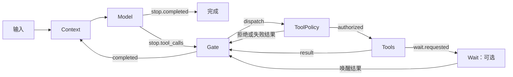

# Mina

Mina 是一个 Rust Agent 框架，使用静态事件订阅图组织单 Agent 的执行。模型、上下文、工具策略、工具执行与等待各自作为节点，通过发布和订阅事件协作。图可以从 YAML/JSON 加载，也可以通过 Rust API 构建，两种入口共用校验和执行引擎。

单 Agent 引擎位于 `agent-core`，模型、工具和存储适配位于 `agent-extension`，多 Agent 的独立总线与编排位于 `agent-harness::multi`。Server、CLI 和 HTTP demo 已接入静态图；旧原生执行路径和固定流水线已移除。

## 文档入口

| 需要做什么 | 文档 |
| --- | --- |
| 编写 YAML/JSON 图，或用 Rust 构建图 | [静态 Agent 图编写指南](docs/design/agent/static-agent-graph.md) |
| 实现并注册自定义节点 | [自定义 Graph 节点](docs/design/agent/custom-graph-nodes.md) |
| 查节点能力、配置字段、输入输出事件 | [Graph 节点参考](docs/design/agent/graph-nodes.md) |
| 选择底层总线或高层 Agent API | [API 与分层](docs/design/agent/operator-only-api.md) |
| 接入宿主资源与配置构建器 | [配置图接入说明](docs/design/agent/configured-operator-graph.md) |
| 运行 HTTP 对话和图片生成示例 | [agent-chat Demo](docs/14-agent-chat-demo.md) |

可直接参考 [纯文本图](config/agents/text.yaml) 和 [工具调用图](config/agents/tools.yaml)。图文件声明节点和订阅关系；Provider 客户端、工具实现、数据库连接与密钥由宿主注入。

## 图如何运行



图在一次 Run 中保持不变，但可以包含循环、分支和多个节点实例。模型直接发布 `stop.*` 事件；Gate 负责通用批次分发和结果汇总。静态图支持审批、外部等待、受限并行工具调用、checkpoint 和恢复。`max_steps` 限制模型轮次，耗尽后失败，不额外调用模型总结。

Core 提供两层接入方式：

- 底层：`OperatorBus` 提供算子与事件订阅、事件发送和投递推进；`GraphEngine` 执行图与提交状态。
- 高层：`GraphAgent` 提供对话流和可选共享上下文准备；`GraphHost` 提供公开事件日志与投影；`AgentEngine` 提供后台运行、审批、取消、分页事件读取和恢复。

持久化能力由注入的存储决定。MemoryFabric 只在进程内保存状态；跨进程恢复需要持久化 Fabric 和匹配的资源 revision。恢复不会盲目重放中断的模型调用或非幂等外部副作用。

## 快速运行 HTTP demo

要求 Rust 1.92+。在仓库根目录执行：

```bash
cp config/agent-chat-demo.example.toml config/agent-chat-demo.toml
# 编辑配置中的对话模型、生图模型及各自服务地址
export OPENAI_API_KEY='your-api-key'
cargo run -p mina-server --example agent_chat_demo -- config/agent-chat-demo.toml
```

默认监听 `127.0.0.1:8081`。示例配置读取 [demo.yaml](config/agents/demo.yaml)，由 YAML 定义节点、订阅和策略，通过 `[workspace]` 注册目录、读写、搜索及终端工具，并通过 `[image_generation]` 注册生图工具。仅测试文件和终端时可删除生图配置，无需图片服务。若只需要纯文本对话，删除 workspace、生图及其 provider 配置，并将 `graph` 改为 `config/agents/text.yaml`。已有本地配置不会自动启用生图。

workspace 默认示例目录为 `data/agent-chat-demo-workspace`。启用后 demo 直接执行工具，没有人工审批；终端运行宿主进程，不提供系统级隔离。

```bash
curl -N http://127.0.0.1:8081/chat \
  -H 'Content-Type: application/json' \
  -d '{"protocol":"agent-chat/1","conversationId":"demo","turnId":"turn-1","runId":"run-1","input":[{"type":"message","inputId":"input-1","parts":[{"type":"text","text":"你好"}]}]}'
```

Demo 使用内存图状态，没有鉴权或跨进程恢复，适合本地集成。生图结果保存为 PNG，通过 `/images/{id}` 读取；前端代理也需要转发该路径。详见 [Demo 使用说明](docs/14-agent-chat-demo.md)。

## 运行完整工作台

另需 Node.js 22+、pnpm 10+：

```bash
pnpm install
cp config/mina.example.toml config/mina.toml
# 编辑 config/mina.toml 的模型和 Provider 配置
MINA_CONFIG=config/mina.toml pnpm dev
```

- Web：<http://localhost:3000>
- Server：<http://127.0.0.1:8787>
- 健康检查：<http://127.0.0.1:8787/healthz>

Web 会将 `/api/*` 和 `/healthz` 代理到 Server。也可以分别运行 `pnpm dev:web` 和 `pnpm dev:server`。完整工作台与上述独立 demo 使用不同的 HTTP 接口和配置文件；demo 的生图配置不会自动注册到正式 Server。

Server 可用 `MINA_AGENT_GRAPH` 为 tools profile 指定静态图文件；自定义节点可通过 `AgentEngine::with_registry` 接入高层持久化运行接口。

Server 默认使用 `data/runs.sqlite3`，可通过 `MINA_RUN_STORE_PATH` 修改。`MINA_ENGINE_PROFILE` 支持 `operator_v1_tools`（默认）和 `operator_v1_text`，两者使用同一静态图运行时。旧运行数据不自动转换为新图。

## 目录与边界

| 目录 | 职责 |
| --- | --- |
| `crates/core` | 单 Agent 图引擎、总线、节点、API 与端口契约 |
| `crates/extension` | Provider、工具、SQLite、Blob、Workspace 和沙箱适配 |
| `crates/harness` | 宿主流程、事件和任务集成，以及 `multi` 多 Agent 编排 |
| `crates/multi` | 多 Agent API 的兼容导出 |
| `apps/server` | 正式 HTTP Server 与独立 `agent_chat_demo` 示例 |
| `apps/agent-cli` | 命令行 Agent |
| `apps/web` | Next.js 工作台 |
| `packages/browser-agent` | [浏览器 WASM SDK](packages/browser-agent/README.md) |
| `apps/wasm-agent` | 浏览器 SDK 的 React demo |
| `config/agents` | 可加载的静态图示例 |
| `contracts/tool/v1` | [外部工具 ABI 与 JSON Schema](contracts/tool/v1/README.md) |

单 Agent 的内部总线与多 Agent 的任务总线彼此独立，不共享内部 checkpoint。Core 不依赖 Harness、Extension、HTTP 客户端或数据库实现。

## 验证

```bash
pnpm check                                      # 前端、Rust 编译与分层检查
cargo test --workspace --all-targets             # Rust 工作区回归
cargo test -p mina-server --example agent_chat_demo
cargo fmt --all -- --check
bash scripts/check-rust-boundaries.sh
```

图测试覆盖文件/代码构建、事件协议、token 用量、审批、等待、恢复和回收。图片生成使用本地 mock 检查调用与 HTTP 文件读取，真实服务需要单独配置并验证。

更多专题：[架构边界](docs/01-architecture-boundaries.md)、[进程沙箱](docs/10-process-sandbox-and-tool-backends.md)、[Workspace 文件系统](docs/15-workspace-filesystem.md)。历史设计文档中的旧流水线描述不作为当前 API 使用指南。

Core 规范模块入口为 `contracts`（通用契约）、`agent::graph`（图引擎）、`agent::host`（上下文准备与应用运行）、`agent::bus` / `agent::executor`（低层订阅与投递）。完整 API 和通知唤醒机制见 [API 与分层](docs/design/agent/operator-only-api.md)。
