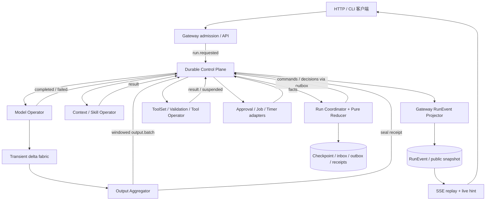
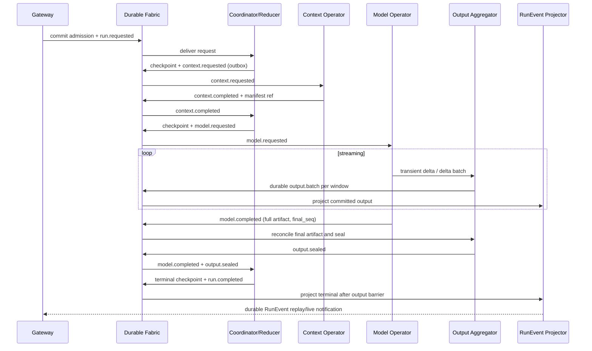
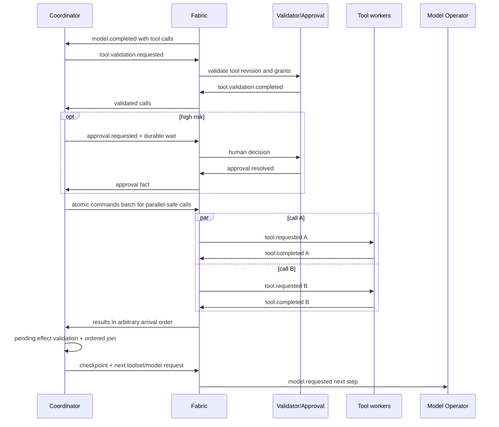
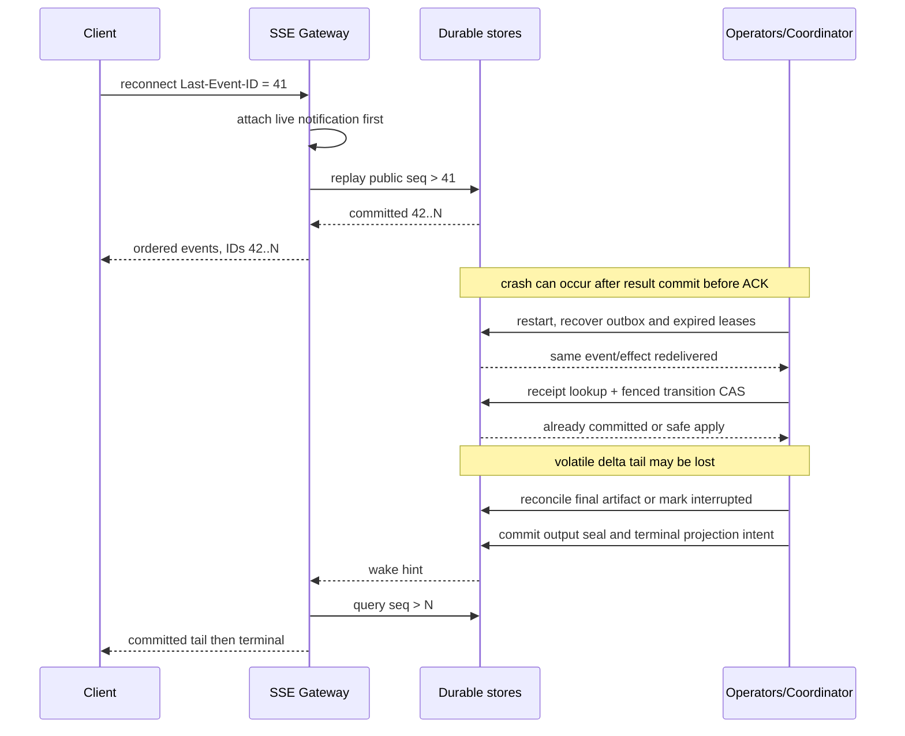

# Mina 单 Agent 全链路事件算子化 Pub/Sub 架构

> 状态：待评审的目标设计，**不是已实现能力声明**。源码核查日期：2026-10-23。范围：当前仓库的单 Agent 原生运行链路；本文不修改 Rust、不引入新服务、不改变多 Agent 协议。

## 1. 执行摘要

当前 Mina 已有纯 `AgentLoopReducer`、durable Flow checkpoint、审批/Job/Timer 事件投递以及 RunEvent SSE/replay，但**没有完成请求 → Context → Model → Tool → Reducer → 输出的全链路算子化**。原生宿主仍在一个 activation 内直接执行 reducer effect，并把模型 delta 逐条送回 reducer。

推荐保留三包组织与现有纯 reducer，以同进程 Event Fabric + SQLite adapter 渐进替换宿主直调：

1. **Event Fabric 只传输**：持久事件、订阅、投递租约、ACK、重试、流式有界通道；不决定 Agent 下一步。
2. **Operator 只做局部计算**：Context 构建、Model 请求、Tool 校验/执行、输出聚合。只能报告事实，不能启动下一轮推理或修改 Run 状态。
3. **Run Reducer/Coordinator 独占 Run 领域状态与下一步决策**：纯 reducer 计算 transition，Coordinator 用 CAS 与 fencing token 原子提交 checkpoint、inbox 消费、outbox 和投影意图。
4. **双平面**：低频业务事实走 Durable Control Plane；高频模型 delta 走 Transient Streaming Data Plane，窗口聚合后成为 durable output batch。不能把“每条 delta 放进一次批量 INSERT”误当成避免逐 token 持久化。
5. **兼容优先**：现有 HTTP 路径、DTO、RunEvent 名称、数字 SSE ID、`after_seq` 和 `Last-Event-ID` 保持；对外默认只发送已持久化的聚合输出，不把无恢复保证的预览伪装成 durable RunEvent。

交付判定：请求处理不再调用 Context 业务编排；Coordinator 不再调用 Model/Tool；每一轮模型与工具执行都由持久命令触发、持久结果驱动 reducer；断线及进程崩溃均不会跳过已提交输出或重复已确认工具副作用。

## 2. 现状核查（真实源码）

以下路径以仓库根目录为基准，行号为本次核查定位；以符号为长期索引。相关旧文档中的“已完成”指其原有范围，不代表本设计已落地。

| 源码定位 | 当前实现 | 与目标的差距 |
|---|---|---|
| `apps/server/src/main.rs:1456` `create_run`；`:1517` `prepare_run_plan` | 校验输入后同步 resolve Skills、`context.build(ContextBuildRequest)`，生成 `PlannedRun`，调用 `runtime.start_planned`；流式返回 SSE，非流式等待终态 | 入口仍承担 Context/Skill 编排，尚非发布请求后由算子订阅处理 |
| `apps/server/src/main.rs:1747` `submit_session_run` | Session 幂等 begin、准备 plan、启动运行；终态任务执行 Session finalize/后续 Memory 工作 | 需保持 Session 幂等、单活跃 Run、消息顺序；把 Agent-managed 编排迁至应用算子，不把它们迁入 Fabric |
| `apps/server/src/main.rs:1121` `start_event_workers` | 250 ms tick，依次调用 Timer、Event、FlowEffect、Job execution/notification dispatcher | 已有外围事件 worker，不是 Model/Context/Tool 全链路 broker；串行 tick 不适合承载长模型请求 |
| `apps/server/src/main.rs:128` `ServerDeliveryRouter`；`:164` `ServerFlowEffectRouter`；`:196` `ServerJobRouter` | 桥接 wake、Flow effect、Job 等已注册业务处理 | 可拆成注册表与基础 adapter，但 Agent 决策不应留在 Server 路由器 |
| `apps/server/src/main.rs:2040` `get_run_events`；`:2072` `run_event_response`；`:2182` `sse_event` | query `after_seq` 优先于 header `last-event-id`；512 条分页回放；live seq 缺口/Lagged 触发回放；等待中的 Run 无 live receiver 时每 200 ms 重查；SSE ID 为 `RunEvent.seq` | 保留公共契约；目标消除未落盘 live event 的恢复空窗，并明确终态可见屏障 |
| `crates/harness/src/run_runtime.rs:64` `RunRuntime`；`start_planned`、`start_machine`、`drive_flows_once` | 支持计划启动、初始 checkpoint、Flow activation claim/resume、续租、Continue/Suspend/终态 | activation 内仍驱动 `MachineStream`；不是每个 effect 独立订阅消费；RunStore 与 FlowStore 提交不是一个通用原子 transition |
| `crates/harness/src/run_runtime.rs:990` `persist_run_events` | mpsc 容量 1024，40 ms/128 条批写 `RunStore::append_events`，非 delta 边界立即 flush；写超时 10 s | 是**写入批量**，仍保存独立 delta 事件；machine 事件分支先 `sender.send` 再交持久化队列（约 `:472`），不能假定所有 live 输出已经 durable |
| `crates/core/src/harness/agent_loop/machine.rs:54` `impl AgentMachine for AgentLoop` | `initial_checkpoint/start/resume` 委托 `native_reducer` | 此文件后面的测试用执行辅助函数带 `cfg(test)`，不能把它们误当成生产主链 |
| `crates/core/src/harness/agent_loop/reducer.rs` `AgentLoopReducer`、`AgentLoopInput`、`AgentLoopEffectKind`、`AgentLoopTransition` | 已有纯状态机、稳定 effect ID、版本化 state、`pending_effects()`；effect 覆盖 LoadToolSet/InvokeModel/ValidateTools/RequestApproval/InvokeTool | 是重用基础，不需要另造业务状态机；现有 ModelEvent 输入包含流式事件，目标需补“聚合完成事实”适配与等价性测试 |
| `crates/core/src/harness/agent_loop/native_reducer.rs:293` 起 effect match；`:490` `execute_tool_effect` | 直接 `tools.tool_set_snapshot`、`provider.stream(request)`、工具校验与 `tools.call_at`；模型事件直接 `AgentLoopReducer::dispatch`；工具可并发，审批/工具 suspend 走 durable wait | 核心待替换位置；`Continue/Suspend` checkpoint 不能等价为每个 reducer transition 已原子持久化 |
| `crates/core/src/event_runtime.rs:62` `PublishEvent`；`EventEnvelope`、`EventStore` | 已有 event ID、topic/type/version、source、correlation/causation、全局 sequence；声明式 filter、Once/Continuous、StartPosition、delivery lease/retry、Timer port | 无通用原子 publish_batch、运行分区 offset、强类型 operator/effect/attempt 元数据与流式协议 |
| `crates/harness/src/event_runtime.rs` `EventRuntime::dispatch_once` | claim 后调用 router，成功 complete_delivery；失败按 attempts 线性增加重试延迟，超过上限 DLQ | ACK 与 handler 的领域提交分离；需以持久 inbox/receipt 保证重新投递安全，不能把返回 Ok 当作外部副作用 exactly-once |
| `crates/extension/src/store/event.rs:68` `SqliteEventStore::publish` | IMMEDIATE 事务内追加 workflow event 与匹配 deliveries；同 event ID 比较完整 command JSON，内容不同冲突；subscribe 可历史补投 | 有单事件事务保证；批次、Run transition、多 Store 事务需要新增契约，不可简单多次调用后宣称原子 |
| `crates/extension/src/store/event.rs:525` `continue_flow_blocking`、`:560` `suspend_flow_blocking`、`:639` `wake_flow_blocking` | Flow checkpoint/inbox/wait/effect 有耐久实现；activation revision/lease 已可复用 | 扩展到每个控制 transition；RunEvent 投影和 effect completion 需要闭合一致性边界 |
| `crates/extension/src/store/event.rs:1524` `claim_deliveries_blocking`；`:1600` `complete_delivery_blocking` | claim 限制同批一个 subscription 一个 delivery；完成时 cursor 取 max(sequence)，投递记录单独保存 | 当前 cursor 不能直接解释为新架构“所有匹配前缀已 ACK”；重试洞与并发语义需显式处理 |
| `crates/multi/src/lib.rs` `Message`、`EventBus`、`InMemoryBus`、`DurableAgentNode`、`serve_durable_node` | 内存 topic broadcast，慢消费者有 Lagged；durable node handler 成功后 ACK | 服务于多 Agent；不能据此推断单 Agent 已接入，也不把 broadcast 当作可靠背压队列 |
| `crates/multi/src/sqlite_bus.rs` `DurableEventBus`、`SqliteBusHandle`、`SqliteSubscription`、`SqliteSupervisorStore` | SQLite message log、consumer/topic offset、read_after/显式 ACK、polling recv；Supervisor 有专门的状态+checkpoint+offset 事务 | 可借鉴协议，但不是通用单 Agent transaction store；不直接复用另一套 messages 表作为 Run 的第二个事实源 |

关联设计依据：

- `docs/06-event-runtime-subscriptions.md` §3/§6/§10/§12/§14：Command/Event/Effect/RunEvent 区别、wait/inbox/outbox、投递与实现范围；明确不持久化每 token、不承诺端到端 exactly-once。
- `docs/09-next-flow-framework.md` §0/§1/§9：现有 Session/Context/Flow 边界、checkpoint 恢复约束；“主线已实现”不能扩展解释为本次 operator pipeline 已实现。
- `docs/08-single-run-state-storage.md`、`docs/02-gateway-agent-protocol.md`、`docs/13-agent-chat-output-adapter.md`：迁移时保留 Run 快照、公共事件及输出通道契约。
- `docs/12-core-extension-consolidation.md`：保持 core/harness/extension 依赖方向，不为每个算子新增 crate。
- `docs/01-architecture-boundaries.md`：Gateway 不拼提示词、不决定下一工具。本文将逻辑归属进一步明确为 foundation / agent / infrastructure / gateway projection；物理 crate 暂不重排。

## 3. 目标与非目标

### 3.1 目标与不可破坏的不变量

- 所有跨业务阶段工作均由持久事件驱动；算子内部调用 ModelPort、ToolPort、Context Engine 等本地依赖是允许的，不要求每个函数事件化。
- 一个 Run 同时至多一个有权提交的 Coordinator；只有它更改业务 phase、messages、预算、pending effects、终态。
- Operator 的任务执行账本、Output 的聚合游标、Gateway 的投影游标是局部状态，不是 Run 决策状态。
- 每个被接受的控制事实有可追溯处理结果：应用、重复、过期丢弃、重试、DLQ；不得悄悄遗漏。
- 数据面丢失不改变工具参数、最终答案、usage 或决策；最终模型结果是完整权威事实，而非依赖零丢失 transient delta 推导。
- 单 Run 的终态不可逆；终态 SSE 必须排在该 Run 已确认输出之后。

### 3.2 非目标

- 不实现跨机器强一致 broker、任意 DAG 编辑器或多 Agent 调度重构。
- 不保证模型 provider 可断点续流、第三方副作用 exactly-once、任意 Future/VM 栈恢复。
- 不把模型完整内部推理默认持久化/公开；仅允许 provider 与现有策略允许的 reasoning 输出通道。
- 不改变现有原生/WASM reducer ABI 而不升级协议版本；不在首期合并 `agent-multi` 的独立协议。

## 4. 总体架构与模块归属



| 逻辑模块 | 第一阶段物理落点（拟新增者明确标注） | 所有权与禁止事项 |
|---|---|---|
| foundation | 现有 `crates/core/src/event_runtime.rs`；拟新增 `crates/core/src/event_fabric/` | ID、信封、订阅/批量/ACK/stream port、错误和 capability；不导入 HTTP、SQLite、Agent 业务状态机 |
| agent reducer | 现有 `crates/core/src/harness/agent_loop/reducer.rs` | Agent 状态与确定性决策；不依赖 Fabric 实现，不执行 IO |
| agent operator/contracts | 拟新增 `crates/core/src/harness/operator.rs`；`crates/harness/src/operators/` | Agent 事件 payload 与 Context/Model/Tool/Output 行为；Agent-managed 工作归这里，不归通用 dispatcher |
| agent coordinator | 拟新增 `crates/harness/src/operator_runtime.rs`；改造 `run_runtime.rs` | 运行业务 reducer、审批/暂停/恢复策略、预算、effect 调度、checkpoint 提交 |
| infrastructure | `crates/extension/src/store/event.rs`、`run.rs`；拟新增 `store/operator.rs`、`transport/stream.rs` | SQLite/内存通道、租约、事务、唤醒通知、时钟；只能执行给定协议 |
| gateway projection | 拟新增 `apps/server/src/run_projection.rs`、`run_api.rs`；瘦身 `main.rs` | 外部 DTO、RunEvent materialization、HTTP 状态映射、SSE；禁止 Context 构建和推理决策 |

投影的纯事件映射可置于 core 的公共契约层，供 CLI 共用；HTTP 连接和 SSE 编码仅在 gateway。进程启动装配仍可由 Server 调用 Harness builder。逻辑目录不是立即拆包承诺，遵守 `core ← extension ← harness/apps` 的现有允许依赖。

### 4.1 正常时序



Fabric 图中提交箭头指 Unit-of-Work 提交 outbox 后异步发布，不是数据库事务跨网络调用。完成事实与 seal 可以先后任意到达，Coordinator 记录两者，不依赖图中的到达顺序。

## 5. 事件模型与契约

### 5.1 信封与身份

在已有 `PublishEvent` 外兼容扩展版本化 metadata，先不强制重写存量 JSON。事件 `event_type` 使用下表稳定名称，topic 建议 `agent.{domain}.v1`；run_id 是分区键，不靠每 Run 创建无限 topic。

| 字段 | 语义与验证 |
|---|---|
| `event_id` | 稳定 UUID；同 ID 同语义内容返回原 receipt，内容不一致冲突；重试必须复用序列化命令，不能更新其 timestamp |
| `schema_version` | payload/schema 独立版本；未知 major 隔离，兼容 reader 可忽略新增 optional 字段 |
| `tenant_id / run_id / session_id` | 必须由可信 admission 赋值；run 分区、权限、数据隔离边界；Session 可以缺省 |
| `correlation_id` | 整个 Run 的关联 ID，通常等于 run_id；跨 Job/Timer 保持，不用它替代幂等键 |
| `causation_id` | 直接触发事件 ID；fan-in 用主触发事件 + payload `input_event_ids`，不可丢失其他输入出处 |
| `effect_id / invocation_id / attempt` | reducer 稳定逻辑动作 ID；一次执行 invocation；重试 attempt 区分实际外部调用；重投递不自动增加 attempt |
| `issued_revision / lease_epoch` | 命令创建时的 Run revision、执行任务 fencing token；领域有效性与存储写权限分别判断 |
| `operator_id / operator_seq` | 每 `(run, effect, attempt, producer)` 单调序号；从 1 起，持久事件序号由任务账本恢复，不用进程局部计数重置 |
| `partition_seq / log_sequence` | adapter 分配分区顺序/存储日志位置；旧 `EventEnvelope.sequence` 可作 log_sequence，不是客户端序号 |
| `occurred_at / recorded_at / deadline` | 时间仅用于观测和超时；顺序以序号为准；新的录入时间由可信 adapter 给出 |
| `trace_id / span_id / payload_ref / digest` | trace 不参与幂等 hash；大 payload 用租户受控 artifact 引用及内容摘要，禁止任意 URL 取数 |

**至少五种序号不可混用**：存储 log sequence、run revision、operator sequence、模型 delta sequence、客户端 RunEvent.seq。`issued_revision` 不等于“结果必须等于当前 revision”：并行工具的第一个结果会推进 revision，后续结果只要仍在 pending effect 集合且 attempt/token 有效，仍必须接受。

### 5.2 完整事件目录

以下均为**目标规范名称**，不声称现有源码同名。`C` 为 durable control（含可回放输出事实），`D` 为 transient data。`requested` 是命令意图；`completed/failed` 等是已发生事实。命令只能由授权主体发布，每个执行命令只有一个逻辑执行 consumer group；观测订阅可广播。

| 事件名（同格列出同类变体） | 平面 | 发布 → 主要订阅 | 必需业务字段 / 作用 |
|---|---|---|---|
| `run.requested` | C | admission → Coordinator | request ref、request hash、Session reservation、engine version |
| `run.accepted / run.started` | C | Coordinator → projection/audit | config/manifest ref；started 表示实际执行开始 |
| `run.rejected` | C | Coordinator → admission/projection | preparation error、安全错误码；兼容旧入口的启动错误 |
| `run.pause.requested / run.resume.requested / run.cancel.requested` | C | API/策略 → Coordinator | command ID、reason、操作者、期望 run identity |
| `run.paused / run.resumed / run.waiting` | C | Coordinator → projection | pause generation、wait refs、checkpoint revision |
| `run.deadline.exceeded` | C | Timer adapter → Coordinator | deadline ID、generation；视为候选超时事实 |
| `run.completed / run.failed / run.cancelled` | C | Coordinator → projection/Session finalizer | finish reason/error、usage、output barrier、terminal revision |
| `context.requested` | C | Coordinator → Context | 锁定输入历史、Skill 选择配置、Memory scope、预算 |
| `context.completed / context.failed` | C | Context → Coordinator | ContextPack/manifest refs、fingerprint、SkillLock、artifact refs/error |
| `toolset.requested / toolset.completed / toolset.failed` | C | Coordinator ↔ ToolSet | run capability、tool_set_revision/digest、有效工具集合 |
| `model.requested` | C | Coordinator → Model | ModelRequest ref、purpose、provider config ref、预算、deadline |
| `model.started` | C | Model → Coordinator/output/audit | invocation/attempt、stream ID、provider request ID（若支持） |
| `model.delta / model.delta.batch` | D | Model → Output | 单条或数组 DeltaItem；text/reasoning/tool-call fragments |
| `model.completed / model.failed / model.interrupted` | C | Model/任务恢复器 → Coordinator/Output | 完整结果 artifact、usage、finish reason、final delta seq、digest；失败可带 partial artifact |
| `model.cancel.requested / model.cancelled` | C | Coordinator ↔ Model | effect/attempt、取消 generation；不代表 provider 已撤销计费 |
| `tool.validation.requested / tool.validation.completed / tool.validation.failed` | C | Coordinator ↔ Validator | tool revision、calls、逐 call 校验结果；不产生工具副作用 |
| `tool.requested / tool.started` | C | Coordinator → Tool；Tool → audit | call ID、已校验 arguments ref、授权/审批 ref、execution policy、幂等键 |
| `tool.completed / tool.failed / tool.suspended` | C | Tool → Coordinator | result artifact/error；suspension 包含 validated waits/effects |
| `tool.resume.ready` | C | Job/Timer/外部桥 → Coordinator | wait_key、call ID、result ref；由 Coordinator 决定恢复 |
| `tool.cancel.requested / tool.cancelled` | C | Coordinator ↔ Tool | fencing token、cancel reason、实际取消能力 |
| `approval.requested / approval.resolved / approval.expired / approval.cancelled` | C | Coordinator/审批 adapter → 用户视图/Coordinator | approval ID、tool 参数摘要、decision、actor、过期时间；决议冲突拒绝 |
| `job.requested / job.started` | C | Coordinator/已授权 Tool → Job adapter | stable job ID、kind、payload ref、deadline；仅启动已记录意图 |
| `job.completed / job.failed / job.cancel.requested / job.cancelled` | C | Job/Coordinator → wait bridge/Job | job ID、attempt、结果 ref/error；结果桥接不直接调用 Model |
| `timer.schedule.requested / timer.scheduled / timer.fired / timer.cancel.requested / timer.cancelled` | C | Coordinator ↔ Timer adapter | timer ID、fire_at、purpose、generation；一次性 Timer，Cron 后置 |
| `output.batch / output.sealed / output.failed` | C | Output → projection/Coordinator | stream range、segments、artifact ref、覆盖 digest/seal 或不可恢复错误 |
| `output.preview / output.preview.gap` | D | Output → 可选新版本客户端 | 无 SSE durable ID；预览丢失/重置提示；旧 API 默认禁用 |
| `delivery.dead_lettered / operator.execution.uncertain` | C | infrastructure/任务恢复器 → 运维/Coordinator | 原事件、attempt、错误、安全副作用状态；不能无限等待 |
| `session.finalize.requested / session.finalized / session.finalize.failed` | C | terminal consumer ↔ Session operator | terminal revision 幂等键；维护会话历史，不重新决定 Run 终态 |

Job/Timer adapter 兼容现有事件名称与 payload 的转换表必须集中管理，并附契约测试；不把存量等待订阅默默改为新 topic。Memory extraction 等终态后行为可复用 Job，必须有 durable intent，不依赖 HTTP 请求后台 task 的存活。

## 6. 算子职责与边界

| 算子 | 局部计算/输入输出 | 禁止事项 |
|---|---|---|
| Admission | 鉴权、配额、输入 schema/blob ownership 校验；事务写请求及 Session reservation | 不构建 Context、不调用 Model |
| Context | 迁入 `prepare_run_plan` 的 Skill resolution、Context/Memory/Compression；保存可复用结果和锁定 manifest | 不直接启动 AgentLoop；不修改会话原始历史 |
| ToolSet/Validator | 快照有效工具集、校验 schema/权限/revision、脱敏参数 | 不把校验成功等同审批通过；执行前仍检查授权有效性 |
| Model | 执行一个已授权 ModelRequest；本地累积完整文本/tool calls/usage；流式发布 delta；持久完成事实 | 不执行工具、不决定下一轮、不用 preview 充当最终结果 |
| Tool | 执行单 call 或隔离的 task；尊重幂等/超时/并发策略；返回 completed/failed/suspended | 不修改 messages、不循环调用 Model；非幂等失败不能自行无限重试 |
| Approval/Job/Timer | 复用已有 durable subsystem，规范化请求与结果 | 不独占 Run 决策；迟到完成由 Coordinator 判定 |
| Output | 校验流序号、窗口聚合、最终 artifact 对账与 seal；维护局部 coverage | 不决定 Run 成功或工具调用，不直接写 reducer state |
| Coordinator | 认领 Run inbox、调用纯 reducer、原子提交 transition；驱动下一步/取消/超时 | 不等待模型网络流、不直接调用工具 |
| Gateway projector | 已提交事实 → 现有 RunEvent/公共 snapshot，生成客户端 seq；通知 SSE | 不控制 Agent 分支；公共 snapshot 是可重建视图，不是第二份可写业务状态 |

## 7. 单事件、批量事件、流式事件

### 7.1 单事件 Pub/Sub 与 ACK

`publish` 的成功只表示事件及匹配 delivery 已提交，并不表示业务成功。持久订阅先注册，再接受请求；临时 wait 在 checkpoint 事务中注册并历史匹配，避免“先收到结果、后建订阅”丢唤醒。

执行 consumer group 的多 worker 竞争 lease；不同逻辑订阅各自收到副本。订阅标识和 filter/version 持久化；同 subscription ID 改 filter 必须显式迁移，不能沿用旧 offset 猜测回放范围。

ACK 分两层：

- **传输 ACK**：成功插入去重的 operator task inbox / Run inbox 后即可 ACK delivery；网络 IO 不占着 dispatcher lease。
- **任务完成**：operator worker 有独立 lease/attempt/fencing，完成结果+receipt+outbox 原子提交后标记完成。不能只 ACK 后把任务留在内存。

旧 dispatcher 可暂时在 handler 完成后 ACK；handler 的持久 inbox/receipt 保证“已提交、未 ACK”重投安全。新 adapter 支持同库将 ACK 合入事务，但上层协议不能依赖跨数据库原子性。

### 7.2 Batch publish/subscribe 与原子性边界

- `publish_batch(batch_id, partition, events)`：首期只允许同 tenant、同 run 分区、同 store 的有界批次；事件逐条有 ID，另有稳定 batch manifest hash；SQLite 单事务全部追加+创建 deliveries，任一冲突整个回滚。
- 批次重试返回原 receipt；同 batch ID 不同事件集合/顺序拒绝。事务内预检已存在事件，同内容可复用；receipt 明确各事件 sequence，不假定所有重试事件仍占连续日志区间。
- 跨 Run 批量提交只能是明确标为 best-effort 的多批次结果，绝不包装成全局原子事务；SQLite 本可支持更大事务，但首期故意限制锁占用与失败面。
- `subscribe_batch` 有两层：订阅端 `recv_batch(max_items,max_bytes,max_wait)` 是吞吐优化，可能跨发布批次；若业务依赖 producer 原子组，读取 batch manifest 后完整处理，不把一个 delivery page 当成原子组。
- 批量注册订阅由 `register_batch` 扩展同库事务；多个 `Now` 订阅共用注册 watermark，事件与订阅并发按事务先后生效。跨 adapter 不承诺原子注册。
- 消费默认逐条 ACK；同 Run 的一组纯 transition 可顺序 reduce 后一次提交，必须与逐条执行语义相同。批处理中部分外部调用成功不是原子副作用。
- `ack_batch` 只确认明确列出的 token；不能取 `max(seq)` 跳过失败洞。offset 是过滤后匹配投递集合的连续已确认前缀；并发 completion 先记 ACK set，再推进 watermark。不同 topic 的 log 空隙不是丢失。

### 7.3 Delta 与 batch delta 统一语义

`StreamKey = (tenant, run_id, effect_id, attempt, stream_id)`。一次 provider 回调规范化为 `DeltaItem`，每条从 1 开始递增 `delta_seq`；即使跨 text/reasoning/tool-call 通道也共用一个序列。该序列不是 token 数，也不是 operator_seq。

- 单条是长度为 1 的 batch；batch 保留每条原始 seq、channel、call_id/index、fragment，不重新编号。batch 必须内部连续；跨 batch 校验重复/缺口/冲突。
- 同 seq 同内容为重复；同 seq 不同 digest 为协议错误；乱序只允许小窗口缓冲，超限进入 gap repair，不无限等待。
- 文本只在同通道相邻区间合并；tool-call fragments 按 call_id/index 保序累积。禁止以“最后值覆盖”压缩 append 型参数 JSON；工具执行仅依赖最终已解析/校验 calls。
- `model.completed` 包含 `final_delta_seq`、每通道完整结果及 digest、规范化 fragment journal 的 artifact 引用。journal 可在结束时整批写入，而非每 token 写数据库；它让丢失区间可重建且验证已有 durable prefix。
- Model Operator 本地完整结果累积有字节上限；大结果分块 artifact，达到上限中断并给出安全错误，不靠无限 RAM 维持可靠性。

### 7.4 Transient → durable 输出窗口

推荐初始参数（待压测，不是已有性能承诺）：单 stream 队列 256 items/1 MiB；聚合窗口 40 ms、128 fragments 或 32 KiB 任一先到；单 Run 输出总量与并发 stream 另设限额。全局、租户、Run 三层内存预算同时生效。

Output Aggregator 把一个窗口变成一个 `output.batch`：`batch_id`、`first_seq..last_seq`、有序合并 segments、源 fragment digest、channel coverage。存的是合并后的文本区间/参数区间及必要定位信息，**不是 128 条原始 delta 换一次 SQL 提交**。跨通道交错可以产生多个 segments；最终 artifact 仅为对账与规范结果，不回灌逐 token 事件表。

聚合事务同时更新 `(stream_key, durable_through_seq)`、写 output batch/outbox；批次重投、重启重新组窗不能覆盖已提交区间。single/batch 输入的不同分组最终应产生相同内容与 coverage，但不要求窗口边界或公共 seq 数量相同。

Output 只能接收 Coordinator 已提交授权的 effect/attempt，不能靠先到的 delta 自行创建合法 stream；每次 flush 检查执行 epoch 与取消截断点。取消、attempt 更换与 output flush 在同库通过 fencing/coverage CAS 仲裁；分库时先保存候选 batch，由 Coordinator 授权的 stream generation/barrier 决定可投影范围。旧 worker 的晚到 delta 不得绕过控制面的 stale 防护写入客户端结果。

背压路径：Output 有界队列满 → Model 发布 await → 暂停读取 provider stream。若 provider 不支持暂停/缓存过大，允许丢弃**可重建预览**并记录 gap；Model 继续维护完整权威结果。工具参数不可静默丢失于权威累积器。最终完成时 Output 从 artifact 修复缺口、核对已提交前缀，再 flush 尾部并发 `output.sealed`。

不能继续累积或 durable store 故障时：到限停止请求/标记 interrupted，而非无界缓冲。控制队列、取消与 lease 心跳有独立容量，不能被 delta 洪峰饿死。任何 seal/failure/terminal 边界强制 flush；终态不能越过未修复的 output gap。

## 8. Reducer / 状态机与并发

### 8.1 重用而非重写

以 `AgentLoopReducerState`、`AgentLoopEffect` 和稳定 effect_id 为核心，增加外层 `RunCoordinatorState` 管理 Preparing/Paused/Cancelling/OutputDraining 等 Run 生命周期。外层不是第二个自主 Agent：其 transition 与内层 reducer state 在同一 checkpoint、同一 revision 下提交。

| phase | 接受事实 | 决策/下一 phase |
|---|---|---|
| Preparing | run.requested/context.completed | 发布 context/toolset 命令；上下文完成后进入原 reducer |
| AwaitingToolSet/Validation | toolset/validation result | 映射现有 ToolSetLoaded/ToolsValidated 等输入 |
| AwaitingModel | model.completed/failed/interrupted | 完整结果映射 reducer 模型输入；产生工具计划或最终回答 |
| AwaitingApproval | approval.resolved/expired | 决策后才能发布 tool.requested；拒绝走原错误/结果语义 |
| AwaitingTools | tool completed/failed/suspended | 收集所有 pending call，按原请求顺序写 messages；满足 join 后继续 |
| Waiting/Paused | wait fact/resume/cancel | 保存结果但暂停时不发新执行命令；resume 检查 generation |
| OutputDraining | model outcome + output seal/failure | 屏障满足后提交完成/失败；非终态模型也记录 seal 屏障以保证跨轮输出顺序 |
| Cancelling | cancel receipt/清理截止 | 立即使旧 effect 无效，清理异步进行；终态注明可能仍在外部执行 |
| Terminal | 任意迟到事实 | 审计、去重、补偿提示；不再推进业务状态 |

第一步可在 Coordinator 内用完整 `model.completed` artifact 重建现有 `AgentLoopInput::ModelEvent` 序列，纯内存执行多次 dispatch，过滤已经由 Output 投影的 delta，只提交一个 transition。之后增加版本化聚合 ModelTurn 输入优化；必须证明最终 messages/tool plan/usage 与旧 reducer 一致。不能在 provider delta 回调中再调用 reducer，否则只是换了外层名称。

### 8.2 Tool loop 时序



有副作用或声明 serial 的工具不可因事件总线而并行；ToolSet revision、ADF grants、审批摘要绑定到具体参数 digest。工具完成顺序不等于 messages 顺序。

### 8.3 Revision / stale event 防护

1. Coordinator claim 生成递增 `lease_epoch`；每次提交检查 owner、epoch、租约有效性及 expected_revision。租约过期的旧 worker 即使重新获得线程调度也不能写。
2. 收到结果检查 tenant/run、pending effect、attempt、任务 lease epoch、tool revision、结果 hash。过期 attempt 的事实可审计，不可改变当前 state。
3. Result 的 issued_revision 与 pending effect 创建 revision 对比，不与当前 Run revision 做盲目相等比较；并发 call 的合法结果不得被误杀。
4. 对一个 run 串行 reduce；不同 Run 可并发；独立纯校验或 parallel-safe Tool 可并发。模型默认每 Run 一次 AgentStep invocation；summary/title purpose 使用独立 effect 身份与预算。
5. reducer 生成的下一步 effect 必须随 checkpoint 提交后才能发布；外部结果只表示事实，不能绕过 pending 检查触发下一轮。

## 9. 核心 Rust 契约草案

以下为接口草图，未声称可直接编译；沿用现有 BoxFuture/serde 风格，错误类型和配置辅助类型省略。foundation 只放通用传输 DTO，Agent payload 与 transition port 放 Agent contracts。首期可以用 wrapper 兼容 `EventStore`，但不得用 wrapper 伪造原子能力。

```rust
type FabricFuture<'scope, Output> =
    Pin<Box<dyn Future<Output = Result<Output, FabricError>> + Send + 'scope>>;

struct PublishBatch {
    batch_id: BatchId,
    partition: PartitionKey,
    events: Vec<PublishEvent>,
}

trait DurableFabric: Send + Sync {
    fn publish(&self, event: PublishEvent) -> FabricFuture<'_, PublishResult>;
    fn publish_batch(&self, batch: PublishBatch) -> FabricFuture<'_, BatchReceipt>;
    fn subscribe(&self, spec: SubscriptionSpec) -> FabricFuture<'_, SubscriptionId>;
    fn recv_batch(&self, claim: ClaimBatch) -> FabricFuture<'_, Vec<DeliveryEnvelope>>;
    fn ack_batch(&self, tokens: Vec<AckToken>) -> FabricFuture<'_, AckReceipt>;
}

struct DeltaItem {
    delta_seq: u64,
    channel: DeltaChannel,
    call_id: Option<String>,
    fragment: String,
}

enum DeltaFrame {
    One { key: StreamKey, item: DeltaItem },
    Batch { key: StreamKey, items: Vec<DeltaItem> },
}

trait StreamingFabric: Send + Sync {
    fn publish(&self, frame: DeltaFrame) -> FabricFuture<'_, StreamReceipt>;
    fn subscribe(&self, spec: StreamSubscription) -> FabricFuture<'_, DeltaStream>;
}

enum RunFact {
    ContextCompleted(ContextResult),
    ModelCompleted(ModelResultRef),
    ToolFinished(ToolResult),
    ApprovalResolved(ApprovalFact),
    OutputSealed(OutputSeal),
    CancelRequested(CancelCommand),
}

struct RunTransition {
    run_id: RunId,
    expected_revision: u64,
    lease_epoch: u64,
    consumed: Vec<InboxToken>,
    checkpoint: CheckpointEnvelope,
    outbox: Vec<PublishEvent>,
    projection_intents: Vec<ProjectionIntent>,
}

trait RunTransitionStore: Send + Sync {
    fn commit(&self, transition: RunTransition) -> FabricFuture<'_, CommitReceipt>;
}

trait Operator: Send + Sync {
    fn execute(&self, task: OperatorTask) -> FabricFuture<'_, OperatorResult>;
}
```

`OperatorResult` 是局部结果+可发布事实，不包含任意 Run state patch。通用 task runtime 负责认领、续租、完成账本与 outbox；Model 可注入 `StreamingFabric`，不通过 trait 回调 Coordinator。`StreamReceipt` 仅表示排入有界通道或显式降级，不表示 durable；`CommitReceipt` 才代表 checkpoint 已落盘。

接口实现必须声明 capability：atomic publish batch、atomic transition、ordered partition、durable subscription、stream backpressure。缺能力时报配置错误，不能静默降级为多次非事务写入。基础端口不暴露 `rusqlite::Transaction`，事务聚合由 infrastructure 实现。

## 10. 持久化、幂等与恢复

### 10.1 事务与存储边界

首期推荐同 SQLite 数据库承载单 Agent 的 workflow、operator task、checkpoint、outbox 及 projection inbox；由 adapter 共用事务入口，不能因为文件路径相同就认为两个连接/两次 trait 调用原子。

| 事务 | 必须共同提交的记录 |
|---|---|
| Admission | submission 幂等键+hash、Run reservation、Session active-run 约束/输入消息归属、run.requested outbox；不得提前 ACK 尚未持久的请求 |
| Delivery handoff | 唯一 `(consumer, event_id)` inbox/task、接收 receipt；可同库附 delivery ACK，异库则先 durable inbox 后 ACK |
| Run transition | processed inbox、expected revision CAS、checkpoint、新 pending effects/决策、命令 outbox、投影意图、wait/Timer 意图；一个提交增加一次 revision |
| Operator completion | task fencing 校验、result artifact ref/hash、completion receipt、result outbox、task status；外部 IO 在事务之外 |
| Output flush | stream coverage CAS、唯一 output batch、projection outbox；seal 包含最终 coverage 和 digest |
| Projection | projection inbox receipt、公共 RunEvent 行与 per-run seq 分配、公共 snapshot 更新、projection cursor；提交后才 live notify |

拟增加的表/索引：`operator_tasks`（effect+attempt 唯一）、`operator_receipts`、`run_inbox`（run+event 唯一）、`run_transition_outbox`、`stream_checkpoints`、`output_batches`（stream+起始 seq 唯一）、`projection_receipts`。优先扩展现有 Flow inbox/outbox，不创建功能重叠但彼此不一致的双写表。最终表名由迁移实现确定。

若保留独立 RunStore 数据库：checkpoint 事务提交 projection outbox，Projector 至少一次消费，在 RunStore 用唯一 source event/segment key 去重；领域状态与公共状态允许短暂滞后。禁止先标公共 Completed 再补输出。Session finalize 等待可投影的终态 receipt，而不是猜 snapshot 已同步。

### 10.2 幂等、重试、offset 与 DLQ

- event ID、batch ID、consumer receipt、effect ID、外部 idempotency key 分工不同，不能一个 UUID 包办。每次重投递复用 event；真正业务重试经 Coordinator 批准后新 attempt。
- Context、Validator 可安全重试；模型重试可能额外收费且结果不同。已对旧客户端输出部分结果的 invocation 默认**不自动重生成并拼接**，应中断 Run，或由明确新协议提供 replacement segment。
- Tool：有 provider 幂等键时使用稳定 effect key；可查询结果时先 reconcile；非幂等且“可能已执行但无 receipt”进入 `operator.execution.uncertain`，禁止自动重试。数据库 exactly-once receipt 不等于外部 exactly-once。
- transport 重试使用有界指数退避+jitter（区别于当前线性退避），按错误类别及重试预算；配置最大次数、最大累计时间；不把 schema/权限错误当瞬时故障。
- offset 按 `(consumer_group, subscription_version, partition)` 维护。ACK holes 必须保存；DLQ 是显式处理决定，写 dead-letter 记录后才可跳过该投递继续前缀，受影响 Run 应收到失败/人工处理事实，不能卡死无声。
- DLQ 记录原事件引用、错误分类、attempt、trace、首次/末次时间，不重复泄露敏感 payload。运维 redrive 重新激活 delivery，保留 event ID；要重新执行业务必须由 Coordinator 创建新 effect/attempt 并审计。
- replay 有两种：恢复消费从 durable offset 继续；重建投影从 log/快照回放。离线 reducer shadow/replay 不执行 effect、不调用 provider，不借 replay 重做外部副作用。

### 10.3 Checkpoint 内容与恢复流程

checkpoint 至少包含：schema/protocol/engine version、Run revision、phase、原 reducer state、Context fingerprint/SkillLock/Memory+artifact refs、模型配置锁、ToolSet revision、pending effects 与合法 attempts、审批/waits、绝对 deadline、cancel/pause generation、预算/usage、各 invocation 的输出 seal 状态与终态屏障。大 messages 可引用 immutable artifact，不保存 Future。

启动恢复顺序：先迁移与版本检查 → 注册 operator subscriptions → 恢复 outbox/未交付事件 → 回收过期 task/Coordinator lease → reconcile 外部执行状态 → 恢复 Run inbox → 补齐投影 → 开放写流量。不同 schema 的 checkpoint 不得直接反序列化猜测；无法升级则隔离并报告。



崩溃点处理：

| 崩溃点 | 恢复规则 |
|---|---|
| 请求已持久，尚未派发 | admission outbox 重投同 event，reservation 不重复创建 |
| checkpoint 已提交，命令未发布 | outbox 重发，pending effect 不会遗漏 |
| 外部 Model/Tool 已完成，结果未提交 | 查询 provider/幂等 key；无法证明则 uncertain，不能把超时当作未执行 |
| 结果提交后未 ACK | receipt 命中返回成功，不重执行；补 ACK |
| output batch 已提交，通知未发 | SSE 从 RunEvent 回放；Projector 从 receipt/outbox 补投影 |
| transient delta 丢失但 final artifact 已提交 | 根据规范化 journal 补缺区间、验证前缀、seal，无重复拼接 |
| provider 中途崩溃且无可恢复结果 | 保留已 durable 部分，发 interrupted/failed；首期默认失败不混接不同生成结果 |
| Run 终态已提交，Session 未 finalize | durable terminal consumer 幂等补偿，保留 session 消息唯一约束 |

### 10.4 取消、暂停与超时

- 取消命令先持久化，由 Coordinator fence pending effects 并发布各 task cancel 意图；本地 CancellationToken 是提速信号，不是唯一事实源。输出截断点进入取消 transition，随后迟到结果只审计。
- 暂停默认 drain 到可 checkpoint 的安全边界；进行中的副作用工具不假装可回滚。Model 若不能冻结，可选择完成当前 invocation 再暂停或取消并标 interrupted，策略必须进入 manifest。
- 恢复携带 pause generation，重复 resume 幂等，旧 generation 不启动新任务；paused 时可以接收完成事实，但不发下一轮命令。
- Run/effect deadline 使用持久 Timer + 本地 timeout 加速；Timer 事实包含 effect/attempt/generation。到达时 Coordinator 比较当前 pending 状态；成功与超时竞争按首个有效提交裁决，迟到另一方无效。
- 终态取消不保证远端 side effect 已停止；公共响应与审计必须区分“Run 不再继续”和“外部操作已确认停止”。

## 11. SSE / API 兼容

### 11.1 请求与响应

保留 `/api/v1/runs`、Session submit、get/cancel/approval 等路径及现有 DTO。旧非流式 create 仍等待最终 `RunResponse`；旧 stream create 返回现有事件格式。新内部 run.requested 并不强迫 API 改为 202。

必须保留当前准备阶段 HTTP 错误语义：同步 schema/鉴权/blob 错误仍立即返回；Skill/context 业务准备变为事件处理后，旧入口用 admission barrier 等待 `context.completed` 或 `run.rejected`，未发送 SSE headers 前映射原有 400/422 等错误。等待只是协议兼容，不是 Gateway 执行业务。连接断开不丢 durable 请求；新的异步接入模式未来显式版本化，不能默默改变现有状态码。

Session submit 保留现有幂等 key/hash 冲突行为和 accepted response 中的 Run 归属。现有 stateless create 不凭空获得客户端重试幂等保证：若新增可选 idempotency key，需明确作用域与有效期；没有 key 的独立请求仍可能是新 Run。

### 11.2 RunEvent 投影

- `output.batch` 投影成现有 `OutputDelta` / `ToolCallArgumentsDelta`，字段含义与 event_name 不变，只是字符串 chunk 更大；所有稳定非 delta 事件仍按现有 `RunEventKind` 映射。
- 一个 batch 可生成多个 RunEvent，按有序 segments 分配连续 `RunEvent.seq`；映射键为 `(source_event_id, projection_version, segment_index)`，与 checkpoint revision、delta_seq 无关。
- 投影前固定 parser/映射版本；同一个 Run 不因部署升级而重新分段、重编号。公开输出文本语义必须相同，不承诺每个 provider chunk 对应一个 SSE frame。
- Projector 维护每 invocation coverage 与跨轮屏障；终态意图带 expected seals/最后业务输出标识。缺输出时先补，再分配终态 seq。公共 snapshot 不得先显示 Completed 让 SSE 提前退出。
- Projection writer 是公共 seq 的唯一分配者；旧执行器和新 projector 不能同时给同一 Run 写 RunEvent。

### 11.3 Last-Event-ID、追赶与保留期

1. 保留当前 `after_seq` 优先、header 次之、默认 0 的解析规则与数字 SSE ID，绑定当前 URL run_id 校验权限。
2. 先订阅 live hint，再查询 durable RunEvent；分页 `seq > cursor`（初期沿用 512）。通知只提示查库，不携带尚未落盘的权威事件。
3. 回放结束后等待通知并定期查库；seq 缺口、Lagged、重连、跨进程丢通知都回查，不直接跳到最大序号。
4. `follow=false` 只回放当前可读事件；终态只有在屏障满足且投影已提交才结束连接。慢 SSE 消费者有界缓冲，溢出断开让其恢复，不反向无限阻塞 Agent。
5. 初期在承诺的 Run 可查询生命周期内保留完整 RunEvent。若后续做 retention，过旧 cursor 返回明确 `replay_expired`/新版本 410 + snapshot 水位，不能静默跳到最新；相应 API 行为需另行兼容评审。
6. 可选 preview 使用独立、显式协商通道，不附数字 durable SSE ID；旧接口不发送不可回放事件，避免 Last-Event-ID 越过尚未提交输出。

## 12. 错误处理、背压与安全

- **故障隔离**：dispatcher 只投递到 durable inbox；Context、Model、Tool、projection 各自 worker pool/并发上限；慢 provider 不阻塞 Timer、取消和其他 Run。
- **容量**：durable backlog 达阈值限制新 admission，不丢控制事实；按租户公平调度；payload、batch bytes、tool result、artifact、等待数均设上限。磁盘满时停止接新任务，不 ACK 未保存事实。
- **控制饥饿**：单独高优先级但有配额的 cancel/lease 通道；无界高优先级同样不可接受；重试也计入预算。
- **安全隔离**：subscription filter 强制 tenant/run scope；topic 名不是授权。用户不能伪造 model.completed、approval.resolved 或外部已完成 receipt。
- **工具安全**：命令绑定参数 hash、tool revision、审批 actor/expiry、allow-list/ADF grants；执行前再次校验；审批后参数改变必须重新审批。
- **敏感数据**：credentials 不进 event payload；只保存 provider config ref；公开 arguments 使用现有 public_arguments；日志仅摘要。reasoning 存储/公开受策略控制，artifact 同样有访问控制、TTL 与删除规则。
- **输入防护**：schema version、JSON 深度、字符串长度、fragment 数与 batch bytes 校验；插件输出视为不可信事实，不能写任意 event type 或 Run state。
- **可恢复清理**：artifact 引用先持久后发布；孤儿清理有 grace period，活跃 checkpoint/outbox/DLQ 引用禁止 GC。内容删除要求与 replay/审计保留冲突需显式政策决策。

## 13. 分阶段迁移计划

每个新 Run 固定 `engine_version=legacy_machine|operator_v1` 与 projection_version；同一 Run 不混用执行器。回滚只影响新 admission，旧 Run 按原版本恢复/排空。所有阶段都保持现有 API；禁止用真实 Model/Tool 双执行做 shadow 对比。

| 阶段 | 文件边界与工作 | 验收标准 | 必须测试 |
|---|---|---|---|
| P0 基线与协议冻结 | `main.rs`、`run_runtime.rs`、`agent_loop/{machine,native_reducer,reducer}.rs` 记录调用链；core 新增 envelope/operator contracts；文档定义映射 | 区分当前/目标；旧 HTTP/SSE fixtures 固定；建立 effect/seq/phase 对照；无执行路径变化 | 现有 reducer、RunStore、Server SSE/Session/approval tests；采集 fake provider traces |
| P1 Fabric 与事务基础 | core event port；harness event runtime；extension `store/event.rs`/新增 operator store、stream adapter | 单/批 publish、订阅/历史回放、租约、receipt、outbox、连续 offset、DLQ；atomic capability 实测；不接真实推理 | 事务 rollback、重复/冲突 batch、ACK holes、租约 fencing、乱序、kill 点恢复；in-memory 与 SQLite 共用契约测试 |
| P2 请求与 Context 算子 | `main.rs::prepare_run_plan` 逻辑迁至 harness Context operator；RunRuntime admission facade；Session adapter | 请求先 durable；Context 由订阅触发；旧准备错误状态码和 Session reservation/幂等不变；可在 Context 后暂接 legacy machine | 同输入 fingerprint/SkillLock 等价；准备失败 rollback/可见性；HTTP 断开和重启；Session 并发提交 |
| P3 Coordinator + Model + Output 纵切 | `native_reducer.rs` effect driver 分离；新增 operator runtime/model/output；RunStore 与 gateway projection | operator_v1 的模型只由 model.requested 启动；默认只推已持久输出；single/batch delta 等价；纯文本 Run 全链路闭合 | fake Model 顺序/乱序/丢尾、final artifact repair、终态屏障、SSE 追赶、崩溃后输出不重复 |
| P4 Tool/Approval/Job/Timer 全闭环 | harness ToolSet/Validator/Tool operators；`ServerDeliveryRouter` 业务迁入 harness；现有 Flow/Job adapters | 全部 effect 请求/结果走 durable fabric；operator_v1 无 Model/Tool 直调宿主分支；并发工具按原序 join；暂停/取消可恢复 | tool loop、approval 重启、may_suspend、Job/Timer 重投、ADF revision、非幂等 uncertain、取消超时竞争 |
| P5 灰度与清理 | `run_runtime.rs` 版本路由；Server API/projection 模块拆分；extension migration/GC；保留旧 checkpoint reader | 新 Run 按比例启用；错误率/延迟/写放大满足约定；旧 Run 排空后移除旧 native driver，不删纯 reducer/WASM port | 长时间压力、进程 kill、磁盘故障、双 worker、升级/回滚、旧 checkpoint/旧客户端兼容、权限隔离 |

P3 若仍有 Tools 未迁完，只对工具禁用/纯文本 profile 开启 operator_v1，不允许遇到工具再在同一个 Run 偷偷退回 legacy。P2 的 Context→legacy 桥是有期限的迁移接缝，不宣称已全链路完成。

测试位置优先复用已有 inline modules 与 `crates/harness/tests/`；adapter 契约 fixture 放 core 可共用测试辅助或各 crate 不形成反向依赖的 fixture，遵守 extension 不依赖 harness 的现有约束。

## 14. 测试与验收矩阵

以下是后续实现的验收计划，**本次仅文档，未声称执行这些测试**。

| 范畴 | 注入/输入 | 必须成立的断言 |
|---|---|---|
| reducer 等价 | 固定 Context/模型结果/工具结果，旧 driver 与新事件 reducer | 最终 messages、calls、usage、finish reason 一致；不要求 chunk 边界相同 |
| 单/批控制事件 | 同事件逐条/批量提交、批中冲突、部分重试 | 原子全有/全无；稳定 receipts；不重复创建 effect |
| 单/批 delta | 任意合法切分、通道交错、Unicode、tool JSON 跨片段 | 最终文本/参数和 source coverage 完全一致；seq 不重编号 |
| 流协议异常 | 重复、乱序、相同 seq 不同内容、缺片段 | 去重/有界缓存/协议失败或 artifact 修复，无静默内容破坏 |
| 背压 | provider 快、Output 慢、SSE 慢、多个租户 | 内存不超配置上限；控制仍推进；慢客户端可恢复；无 token 级事件行放大 |
| durability | 每个事务提交前后 kill，完成后 ACK 前 kill | 无遗漏已提交命令；receipt 去重；终态最多一次；外部不确定操作被显式标记 |
| leases | 旧 worker 停顿超 lease 后恢复，新 worker 接管 | 旧 epoch 写入被拒绝，不能覆盖新 checkpoint/result |
| offsets | 后序先成功、前序重试、filter 非匹配空隙 | watermark 不越失败洞；重启不会漏投；DLQ 跳过有明确记录 |
| SSE | 任意 ID 断连、live Lagged、等待无 receiver、跨进程 | 已提交 seq 连续、无重复内容拼接、最后输出先于 terminal；header/query 优先级不变 |
| 审批与工具 | 高风险工具、审批冲突/过期、并行 call 乱序完成 | 未审批无执行；合法后到结果不被 revision 误杀；结果按 call 原序归并 |
| side effect | 幂等/非幂等 tool 完成但 receipt 丢失 | 幂等可 reconcile；非幂等不盲重试；审计标 uncertain |
| 暂停取消超时 | cancel 与 completed 同时、旧 Timer fired、暂停后 Job 完成 | 单一有效裁决；迟到不复活；恢复只执行当前 pending |
| Session/API | 重复 submission、hash 冲突、context 失败、non-stream | 原有状态码/DTO/消息顺序/独立 Run 行为兼容 |
| schema/升级 | 旧 checkpoint、未知 event major、运行中切版本 | 有明确 reader/迁移或隔离；不双执行、不重编号公共事件 |
| 安全 | 跨 tenant 订阅、伪造审批、恶意大 payload/artifact ref | 拒绝且可审计，无越权执行或数据泄漏 |

建议发布门槛：上述 correctness 测试全过；随机故障注入可重复种子；对照 legacy 基线报告吞吐、首个**durable**输出延迟、SQLite 写事务数/事件字节，不以“减少 flush 次数”冒充减少落盘事件量。40 ms 窗口带来的首字延迟预算由产品评审；无压测前不承诺具体 QPS。

### 14.1 可观测性

- Fabric：publish/commit/dispatch p50/p95/p99、backlog bytes/items、最老未投递年龄、ACK 延迟、重试/DLQ、offset holes、outbox age。
- Coordinator：transition latency、revision CAS conflict、lease expired/fenced writes、stale result 数、每 phase 停留时间、pending effect age、terminal barrier 等待。
- Model/Tool：队列等待、execution duration、attempt、provider usage/费用估算、cancel 传播延迟、uncertain side effects；计费以权威 usage 为准，去重后入账。
- Streaming：每 Run buffer bytes、blocked publish duration、coalescing ratio、gap/repair 数、final artifact size、durable watermark lag、每生成字节对应的持久化字节/行数。
- Projection/SSE：projection lag、replay pages/latency、live lag/disconnect、重复 source receipt、terminal-before-output（必须为 0）。
- Trace 用 correlation/causation/effect/attempt 串联，异步交接用 span link；metric label 不放 run_id、event_id 等高基数字段；定位细节放脱敏日志与 trace。
- 告警优先监测 oldest pending age、持续 outbox 积压、uncertain、DLQ、fencing 异常、output seal 超时；不是只看进程存活。

## 15. 风险、取舍与开放问题

| 风险/取舍 | 推荐处理 | 评审待确认 |
|---|---|---|
| 每阶段多一次 durable hop，首字延迟增加 | 同进程通知+短事务+批量 claim；不把 250 ms polling 作为正常路径唯一唤醒 | 首个 durable 输出延迟 SLO 与默认窗口 |
| 两套 event bus 共存 | 单 Agent 使用扩展后的 EventStore；multi bus 只桥接明确边界，避免双事实源 | 未来是否统一 foundation envelope，另立 ADR |
| Run/Flow/Event 分库原子性 | 单库 Unit-of-Work 优先；分库采用 outbox+幂等投影，不承诺分布式事务 | 现有部署数据库路径与迁移锁窗口 |
| SQLite 写锁竞争、subscription 扫描 | 控制批次大小、索引 tenant/run/type、异步 blocking IO；先压测再换 broker | 活跃 Run/订阅数和输出 retention 容量目标 |
| 模型中断无法续流 | 已输出 invocation 首期失败，不混接重生成答案 | 是否需要版本化 replacement 输出协议 |
| 完整 artifact 与隐私/成本 | bounded artifact、引用去重、访问控制、reasoning 最小化、GC 引用保护 | journal 保留多久、是否允许受限 reasoning 存储 |
| 非幂等外部工具无法证明执行结果 | uncertain + 人工确认/业务补偿；不声称 exactly-once | 各工具幂等分类及 reconcile 能力清单 |
| 新输入 ABI 与浏览器/WASM 漂移 | 先适配既有 reducer 输入，聚合输入版本化；共享 fixtures | 浏览器是否也采用 operator transport，非本期必需 |
| 暂停中的外部执行仍运行 | drain 安全边界，UI 明确暂停语义 | Model 暂停策略、清理超时上限 |
| Session/公共视图异步滞后 | 终态投影屏障+durable finalizer，不由 Gateway 修改领域状态 | UI 是否需要显示 preparing/projecting，不强改旧 DTO |

## 16. 推荐决策

1. 批准“纯 reducer 不重写、native effect driver 逐步替换”的方向；明确 P4 才达到核心全链路算子化。
2. 首期同进程、同 SQLite 事务 adapter；foundation 是逻辑契约层，不新增细碎 crate，也不把 Agent 业务藏进通用 broker。
3. 强制三条边界：Fabric 传输、Operator 局部计算、Coordinator 独占状态/下一步；每个跨阶段动作都有 durable command/result。
4. 原子性以单 Run transition / 同分区 publish batch 为界；外部副作用不纳入 SQLite 原子承诺。默认 at-least-once + inbox/receipt/outbox。
5. 模型 delta 单/批共用序号与内容语义；默认窗口聚合 durable 输出再 SSE，最终 artifact 修复数据面缺口；不逐 token 写事件日志。
6. 守住外部兼容与安全：数字 Last-Event-ID、准备错误状态码、Session 幂等、审批/工具能力、旧 checkpoint 恢复；新 preview/自动重生成均后置显式协议升级。
7. P1/P3 先证明事务与输出恢复正确，再迁移全工具闭环；灰度只切新 Run，真实副作用不做双跑。

## 17. 本文完整性自检

- [x] 核查 Server 入口/SSE/worker、RunRuntime、machine/native reducer/pure reducer、core EventStore、SQLite event adapter、multi 内存/SQLite bus；明确现有与目标差异。
- [x] 覆盖双平面、单/批 Pub/Sub、原子性、delta 序号、窗口聚合、replay/ACK/offset/幂等/重试/DLQ。
- [x] 覆盖 correlation/causation/revision/operator sequence、并发/stale、checkpoint/崩溃恢复、取消/暂停/超时、SSE 追赶与终态屏障。
- [x] 提供 run/context/model/tool/approval/job/timer/output 事件目录、Rust 契约草案、四张 Mermaid 架构/时序图。
- [x] 按运行时归属划分模块；给出分阶段文件边界、验收标准、测试矩阵、指标、风险与推荐决策。
- [x] 仅新增本设计文档；不宣称本文接口或性能参数已经实现、编译或通过运行测试。
