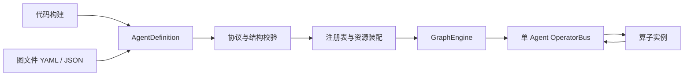
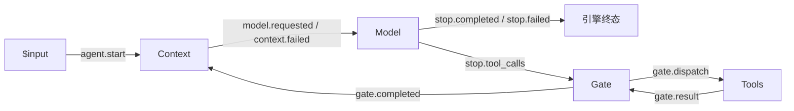

# 静态 Agent 图编写指南

状态：Core 静态图 v1 已实现。

本文说明图文件格式和代码构建方式。各内置节点的配置、事件与连接规则见 [Graph 节点参考](graph-nodes.md)；运行 HTTP 示例见 [Demo 使用说明](../../14-agent-chat-demo.md)。

本文定义单 Agent 内部的静态算子订阅图，不涉及 Harness 中多个 Agent 之间的协作图。文件和代码是两种构建入口，最终都生成同一种 `AgentDefinition`，经过同一套校验和装配，得到同一种 Agent。

实现入口为 `agent::AgentBuilder`，文件与代码共用 `GraphEngine`。可直接参考 [纯文本配置](../../../config/agents/text.yaml) 与 [工具配置](../../../config/agents/tools.yaml)。旧过渡图格式已删除，不提供兼容读取。

当前内置图支持文本、工具、持久化审批、有界幂等重试、外部等待及可选并行执行。GraphAgent 支持逐 token 输出与宿主审批端口。正式 server、独立 agent_chat_demo 和 CLI 已接入静态图；旧固定流水线和审批、工具准备、工具执行适配算子已删除。

## 1. 什么是静态图

静态图固定的是一次 Run 中的算子实例、订阅关系、配置及生命周期协议。运行时只流转事件和更新状态，不增删节点、不改订阅、不重新读取配置文件。

静态图允许循环和分支。有状态节点按订阅顺序处理事件；无状态节点可以声明 `stateless_parallel`，返回的状态必须为 null。工具默认顺序执行，只有配置 `parallel: true` 且整个调用批次均为免审批、立即完成、ParallelSafe 的工具时，才会通过独立投递队列并行执行（最多 16 个）；包含其他工具的批次保持单队列执行。不同 Run 可以并发执行。例如，模型要求调用工具时可以反复经过 `Context → Model → Gate → ToolPolicy → Tools → Gate → Context`。这些行为由算子发布的事件决定，不是动态修改图。



## 2. 编写顺序

1. 选择承担 Agent 决策的算子，确定它接受和发布哪些事件。
2. 添加模型、工具、观察者等需要的算子实例。
3. 用订阅连接发布者和消费者，明确每条边的事件类型。
4. 指定启动事件及正常结束、失败、取消事件。
5. 设置整个 Run 的执行预算；配置各算子的局部限制。
6. 在宿主中注册所引用的算子实现，并注入模型、工具集、存储等资源。
7. 使用构建器校验并装配；校验通过后才能接收 Run。

先确认算子的协议，再连接图。相似的事件名称不代表兼容；订阅关系也不会自动转换 payload。

## 3. 完整示例：模型与工具循环

下面示例使用五种算子，不需要中央 Coordinator。Context 锁定模型可见的工具快照；ToolPolicy 校验和审批；Tools 在执行前重新验证授权。三者引用同一个工具集资源。

```yaml
schema_version: 1
name: tool-assistant
operators:
  context:
    type: agent.context
    version: 1
    config:
      system_prompt: "你是一个简洁、准确的助手。"
      max_steps: 8
      toolset: workspace
  llm:
    type: agent.model
    version: 1
    config:
      model: primary
      timeout_ms: 60000
  gate:
    type: agent.gate
    version: 1
    config: {}
  policy:
    type: agent.tool_policy
    version: 1
    config:
      toolset: workspace
      approval_timeout_ms: 300000
  tools:
    type: agent.tools
    version: 1
    config:
      toolset: workspace
      timeout_ms: 30000
subscriptions:
  - id: start-agent
    subscriber: context
    from: "$input"
    events: [agent.start.v1]
  - id: request-model
    subscriber: llm
    from: context
    events: [model.requested.v1]
  - id: context-failure
    subscriber: llm
    from: context
    events: [context.failed.v1]
  - id: start-tools
    subscriber: gate
    from: llm
    events: [stop.tool_calls.v1]
  - id: authorize-tool
    subscriber: policy
    from: gate
    events: [gate.dispatch.v1]
  - id: approval-decision
    subscriber: policy
    from: "$external"
    events: [approval.decided.v1, approval.expire.v1]
  - id: request-tool
    subscriber: tools
    from: policy
    events: [tool.authorized.v1]
  - id: rejected-tool
    subscriber: gate
    from: policy
    events: [gate.result.v1]
  - id: collect-tools
    subscriber: gate
    from: tools
    events: [gate.result.v1]
  - id: update-context
    subscriber: context
    from: gate
    events: [gate.completed.v1]
lifecycle:
  start:
    event: agent.start.v1
  terminal:
    from: llm
    completed: stop.completed.v1
    failed: stop.failed.v1
    cancelled: stop.cancelled.v1
limits:
  timeout_ms: 900000
  max_deliveries: 10000
```

对应的逻辑关系：



图中的连线表示经由 Bus 的事件订阅，节点之间没有直接函数调用。数组顺序和节点在图上的位置都不构成执行依赖。

## 4. 顶层字段

除特别注明外，字段均为必填。v1 拒绝未知字段，防止拼写错误被忽略。YAML 与 JSON 采用相同的数据结构；YAML 仅使用能够转换成 JSON 的类型，拒绝重复键和自定义标签。

| 字段 | 类型 | 作用 |
| --- | --- | --- |
| `schema_version` | 正整数 | 图格式版本，本文为 `1` |
| `name` | 字符串 | Agent 定义名称，不作为 Run 身份 |
| `operators` | 对象 | 算子实例名到类型、版本和配置的映射 |
| `subscriptions` | 数组 | 发布订阅关系 |
| `lifecycle` | 对象 | 启动与正常业务终态协议 |
| `limits` | 对象 | 整个 Run 的时间和投递预算 |

`schema_version` 是文件格式版本；算子 `version` 是实现契约版本；事件名中的 `.v1` 是 payload 协议版本。三者分别管理，不要求同时升级。

## 5. 算子实例 operators

```yaml
operators:
  llm:
    type: agent.model
    version: 1
    config:
      model: primary
      timeout_ms: 60000
```

- `llm` 是图内实例名，订阅通过它寻址。
- `agent.model` 与 `version: 1` 共同定位注册表中的算子工厂及协议描述。
- `config` 是该类型的配置对象，必填；没有参数时写 `{}`，由算子的配置 Schema 校验。
- 同一种类型可以创建多个实例，每个实例拥有独立的配置、状态和消费身份。
- 实例名使用字母、数字、下划线或连字符，长度为 1–64 字符，不允许以 `$` 开头。

资源引用使用宿主提供的名字。例如 `model: primary` 引用宿主的模型资源，`toolset: workspace` 引用工具集。图不保存客户端对象、存储连接或访问凭据。资源必须在装配时存在且满足算子声明的能力要求。

模型请求轮数上限 `max_steps` 由 Context 在生成请求前检查；模型调用超时属于模型算子；整个 Run 的超时属于 `limits`。不要为同一约束设置多个含义不明的字段。

## 6. 订阅 subscriptions

```yaml
- id: start-tools
  subscriber: gate
  from: llm
  events:
    - stop.tool_calls.v1
```

| 字段 | 作用 |
| --- | --- |
| `id` | 图内唯一订阅 ID，支持消费游标、诊断和配置比较 |
| `subscriber` | 消费事件的算子实例名 |
| `from` | 发布事件的算子实例名或保留来源 |
| `events` | 非空的精确事件类型列表，不允许重复 |

v1 的 `from` 是单个来源，`events` 不支持通配符、正则或 payload 条件表达式。订阅多个发布者时写多条订阅。相同的发布者、消费者和事件组合不得通过不同订阅 ID 重复声明。

一次匹配必须同时满足：同一租户、同一 Run、来源身份一致、事件类型一致。来源身份由引擎绑定，算子不能通过修改 payload 冒充另一个发布者。

保留来源：

| 来源 | 含义 |
| --- | --- |
| `$input` | 宿主通过 `agent.run(input)` 创建的启动事件来源 |
| `$engine` | 当前提供 `engine.terminal.v1` 终态通知（payload 为 object） |

保留来源只能出现在 `from` 中，不能作为 `subscriber` 或自定义节点名。需要消费 `$engine` 事件时，同样要满足注册表中的协议定义，不能凭空填写事件名。

一条事件可被多个实例订阅；每个实例独立消费。一个实例也可订阅多个事件，但它们的先后关系需要由该算子的状态机处理。`from` 只选择发布者，不负责匹配某一次模型或工具调用；调用关联通过事件中的 effect / invocation 身份完成。

图里不要写物理 Topic、租户 ID、Run ID、数据库 key 或消费 offset。引擎根据图及 Run 身份生成这些信息。

## 7. 事件协议与输出

每种事件在注册表中有明确的 payload Schema。事件信封由引擎管理，至少包含事件 ID、租户、Run、发布者实例、事件类型和因果关联信息。模型调用、工具调用等还需要对应的调用身份。

算子发布事件时只提供合法的事件类型、业务数据及规定的关联信息。引擎校验其是否在该算子的输出协议内，并附加可信身份。

算子声明的输入输出应类似：

| 类型 | 接受 | 发布 |
| --- | --- | --- |
| `agent.model@1` | `model.requested.v1`、`context.failed.v1` | `model.output.v1`、`stop.completed.v1`、`stop.tool_calls.v1`、`stop.failed.v1`；声明 `stop.cancelled.v1` |
| `agent.tool_policy@1` | `gate.dispatch.v1`、`approval.decided.v1`、`approval.expire.v1` | `tool.authorized.v1`、`approval.requested.v1`、`approval.finished.v1`、`gate.result.v1` |
| `agent.tools@1` | `gate.dispatch.v1`、`tool.authorized.v1` | `gate.result.v1`、`wait.requested.v1` |
| `agent.wait@1` | `wait.requested.v1`、`wait.woken.v1`、`engine.terminal.v1` | `gate.result.v1` |
| `agent.context@1` | `agent.start.v1`、`gate.completed.v1` | `model.requested.v1`、`context.failed.v1` |
| `agent.gate@1` | `gate.open.v1`、`stop.tool_calls.v1`、`gate.result.v1` | `gate.dispatch.v1`、`gate.completed.v1` |

这些只展示类型关系。真正的 Schema 必须约定请求内容、输出内容、错误格式以及调用关联要求。

模型原始 token 的传输和聚合属于模型执行组件。图上的 `model.output.v1` 是它对其他算子公开的事件协议，不要求每个 token 对应一个总线事件。当前内置模型算子聚合一次调用的输出再发布事件。内部事件不会自动成为 HTTP/SSE 的 RunEvent；宿主可消费 `GraphEngine::subscribe` 或 `events_after` 返回的 `PublishedGraphEvent`，自行适配输出。

## 8. 生命周期与预算

### 启动

调用 `agent.run(input)` 时，引擎创建 Run、固定图与资源绑定，然后以 `$input` 身份发布 `lifecycle.start.event`。输入数据需满足该事件的 Schema。该事件至少有一个合法消费者。

### 结束

`lifecycle.terminal.from` 指定能够提出业务终态的算子实例，三个字段指定完成、失败和取消事件。它们必须是该实例声明可发布的事件，且类型彼此不同。

终态是引擎内置的观察点，不需要额外创建一个结束节点。完成事件的 payload 原样保存为 `GraphRun.output`，内置 Model 的完成 payload 包含 `output`、`round`、`finish_reason` 和本次调用的 `usage`。

引擎用原子状态转换决定唯一终态。已经终止的 Run 不接受后续事件将其恢复为运行中，也不会再次启动模型或工具副作用。观察者可继续消费已经产生的终态事件，其他尚未处理的业务事件会被忽略；终态观察者不能发布后续事件或改变 Run 终态，且仍受投递预算限制。

### 取消与强制失败

宿主取消、整体超时和预算耗尽由引擎直接处理，不依赖图里恰好存在一条控制订阅。它们会设置终态、触发运行中工作的取消信号，并阻止迟到结果推进 Agent。

`lifecycle.terminal` 描述算子主动提出的业务终态，不限制引擎执行这些强制控制。终态通知与公开状态投影需保持一致，不能通知已完成后仍查不到对应状态。

### limits

| 字段 | 类型 | 语义 |
| --- | --- | --- |
| `timeout_ms` | 正整数 | 从 Run 创建开始计时，包含模型和工具执行 |
| `max_deliveries` | 正整数 | Run 内交给算子处理的投递次数上限，包含重试和多订阅者投递 |

预算按 Run 持久化，并在并发领取时原子扣减。单纯查询、回放或被 receipt 直接复用且未调用处理器的投递不消耗执行预算。预算耗尽时引擎终止业务执行；终态状态及通知由引擎持久化，不依赖剩余业务预算。

普通图校验不能证明一个循环一定会结束。`max_deliveries` 与 `timeout_ms` 必须同时设置。算子可以提供更细的调用次数、并发和重试策略，但不能突破引擎预算或自己的协议约束。

## 9. 添加一个自定义订阅分支

例如记录完成结果，先添加实例：

```yaml
operators:
  audit:
    type: app.audit
    version: 1
    config:
      destination: agent-audit
```

再向原图的订阅数组追加：

```yaml
- id: audit-result
  subscriber: audit
  from: llm
  events:
    - stop.completed.v1
    - stop.failed.v1
```

以上是追加片段，不是独立的完整图。宿主必须注册 `app.audit@1`，通过其工厂闭包注入审计客户端，并校验 `destination`。内置命名资源目前只有模型和工具集。它不会因为订阅完成事件就成为新的终态判定者。

如果需要“审计成功后才算任务成功”，就要设计不同的业务协议：自定义模型算子先发布待确认结果，审计算子确认后，再由终态判定者发布完成事件。不要把完成后的观察者误当成完成前的依赖。

事件和副作用可能重试。需要恢复的算子状态应写入 Fabric；外部写入需采用幂等机制或显式的不确定结果处理。仅在 Rust 对象中保存状态无法支持进程重启恢复。

## 10. 两种构建入口

需要扩展节点类型时，先阅读 [注册自定义 Graph 节点](custom-graph-nodes.md)，完成宿主注册后再从文件或代码引用。

以下示例使用已实现的 API；`registry` 和 `resources` 由宿主提供。

### 从文件构建

```rust,ignore
let definition = AgentDefinition::from_file("agents/assistant.yaml")?;
let agent = AgentBuilder::new(registry, resources)
    .build(definition)?;

let run = agent.run(input).await?;
```

文件扩展名选择 YAML 或 JSON 解析器。解析只生成定义，不执行算子。装配时再解析类型、检查资源并建立订阅。

### 从代码构建

```rust,ignore
use agent_core::agent::{AgentGraph, OperatorDefinition, GraphLifecycle, GraphLimits};
use serde_json::json;

let definition = AgentGraph::new("assistant")
    .operator("context", OperatorDefinition::new("agent.context", 1,
        json!({"system_prompt":"你是一个助手", "max_steps":12})))
    .operator("llm", OperatorDefinition::new("agent.model", 1,
        json!({"model":"primary", "timeout_ms":60000})))
    .subscribe("start-agent", "$input", "context", ["agent.start.v1"])
    .subscribe("request-model", "context", "llm", ["model.requested.v1"])
    .subscribe("context-failure", "context", "llm", ["context.failed.v1"])
    .lifecycle(GraphLifecycle::model("llm"))
    .limits(GraphLimits::new(900_000, 10_000))
    .finish()?;
let agent = AgentBuilder::new(registry, resources).build(definition)?;
```

代码中的构建助手负责生成可序列化的类型引用、版本与配置，不绕过图校验，不隐式启动独立执行器。任意自定义实现先注册到 Registry，再由图引用。闭包、客户端和连接等不可序列化对象属于宿主资源，不嵌入定义。

两种入口构建的 Agent 共用运行、订阅输出、查询、取消和恢复 API。代码生成的定义也可以导出成文件；在提供相同算子契约与资源绑定的宿主上，两者应具有相同执行语义。

## 11. 校验规则与常见错误

构建器在创建可运行 Agent 前完成下列检查，并返回能够定位字段路径的错误，例如 `subscriptions[2].subscriber`。

| 检查项 | 应拒绝的情况 |
| --- | --- |
| 文件结构 | 未知版本、未知字段、重复 YAML 键、错误类型、空事件列表 |
| 实例与类型 | 非法或重复实例名，类型或版本未注册 |
| 算子配置 | 不满足该类型的配置 Schema |
| 资源绑定 | 模型、工具集或其他必需资源不存在或类型不匹配 |
| 订阅引用 | 发布者或消费者不存在，保留来源使用错误 |
| 协议兼容 | 发布者不声明该事件，消费者不接受该事件，Schema JSON 不完全相同（当前采用严格相等校验） |
| 重复边 | 重复订阅 ID，或同一发布者、消费者、事件重复连接 |
| 入口与终态 | 无人接收启动事件，终态来源不存在，终态事件不合法 |
| 结构可达性 | 节点从启动或其声明的引擎输入不可达，终态来源不可达 |
| 执行约束 | 预算不是正整数或超出可表示范围 |

循环本身不是错误。多条分支汇合也不会自动等待所有分支完成；需要由接收算子按关联身份收集结果和判断完成条件。

不再硬编码“所有 Agent 都必须恰好具有同一组内置角色”。是否能够省略工具、替换决策算子或增加分支，取决于所选算子的协议声明及图校验结果。纯文本 Agent 应选择不要求工具结果的决策协议，而不是只删掉工具节点却保留悬空订阅。

## 12. 保存、修改与恢复

首次启动 Run 时保存完整的规范化定义快照，包含格式版本、实例、类型版本、配置、订阅、生命周期和预算。YAML 注释与字段排版不属于运行语义。实际生效的资源绑定也需要固定并可核验；凭据由宿主单独管理。

- 修改文件只影响重新构建后创建的新 Run。
- 已有 Run 的恢复使用保存的定义，不读取新文件覆盖原图。
- 恢复需要相同契约版本的算子实现和可用的资源绑定；缺失时明确失败。
- 消费身份按租户、Run、实例及订阅 ID 隔离，不能因两个图同名而共享游标。
- 更改算子语义或事件 Schema 时注册新版本；相同类型版本不得悄悄改变契约。

第一版不提供图热更新、运行中迁移、任意表达式求值或订阅内 payload 转换。需要条件分支、转换或汇合时，使用有明确协议的算子表达。

## 13. 提交一张图之前

确认类型和事件来自注册表，所有资源由宿主提供；检查入口能够到达业务节点和终态判定者；为循环设置预算；确认观察者是否属于完成前依赖；最后分别运行正常完成、模型失败、工具失败、取消和重启恢复场景。

文件能够解析只是第一步。只有通过装配校验并验证预期业务路径，才算得到可使用的 Agent。

## 14. 宿主接入和实现边界

```rust,ignore
use agent_core::agent::{AgentBuilder, AgentResources, OperatorRegistry};

// fabric、model_port、tool_port 由宿主创建；revision 标识实际资源契约。
let resources = AgentResources::new(fabric)
    .model("primary", "provider-v1", model_port)
    .toolset("workspace", "tools-v1", tool_port);
let agent = AgentBuilder::new(OperatorRegistry::builtins(), resources)
    .from_file("config/agents/tools.yaml")?;
let run = agent.run("请帮我完成任务").await?;
// run() 返回已接收的 Run；完成状态通过查询或事件订阅获取。
let events = agent.engine.subscribe("local", run.run_id, 0);
```

`run` 默认租户为 `local`；自定义租户使用 `engine.run(tenant, input)`。引擎提供 `start(tenant, run_id, input)`、`get_run`、`recover`、`cancel` 和 `stop_workers`。`events_after` 的游标是已消费事件数量，每页 1–128 条；`subscribe` 在终态日志读完后结束。应用退出时调用 `stop_workers`。

| 内置类型 | 配置 |
| --- | --- |
| `agent.context@1` | `system_prompt`、`max_steps`（1–100）；可选 `toolset`、`allowed_tools`、`allow_run_adf` |
| `agent.gate@1` | `{}`，固定 all-of 语义 |
| `agent.model@1` | `model` 资源名、`timeout_ms`；可选 `model_name`（提供商模型名）、`max_output_tokens` |
| `agent.tools@1` | `toolset`、`timeout_ms`；可选 `allowed_tools`、`review_level`、`allow_run_adf`、`allow_suspend`、`parallel` |
| `agent.tool_policy@1` | `toolset`、`approval_timeout_ms`；可选 `allowed_tools`、`review_level`、`allow_run_adf` |
| `agent.wait@1` | `wait_service` |

通过 `registry.describe(type, version)` 查看确切的配置和事件 Schema。自定义算子实现 `GraphOperator`，从 `GraphContext` 读取事件和持久化状态，返回 `GraphOutput { state, events }`；使用 `OperatorDescriptor` 声明协议，再调用 `registry.register(descriptor, factory)`。算子状态应放入 `GraphOutput.state`，不依赖实例内存。

引擎原子提交节点状态、输出事件及投递确认，并保存图、协议与资源 revision。恢复时核验这些信息。`replay_safe` 默认为 false：执行中断且无法确定副作用结果时，不盲目重放；恢复会等待原租约或 Run 截止时间，再失败。只有可安全重放的算子才应声明 true；宿主必须随资源语义变化更新 revision。

单事件（含信封和 Schema）最多 64 KiB，每次输出最多 128 条、合计 1 MiB，Run 检查点上限 4 MiB（引擎预留 64 KiB）。模型请求包含会话历史，也受事件大小限制。超限输入拒绝启动，超限算子输出使 Run 以 `output_capacity_exceeded` 失败；大内容需由自定义算子使用外部引用传递。

内存 Fabric 适合测试；跨进程恢复使用持久化 Fabric。后端必须支持原子批次、连续偏移、租约隔离与事务 outbox。

### Checkpoint 中的 token 统计

`GraphRun.usage` 保存累计用量；`GraphRun.step_usage` 按算子状态提交顺序记录实例名、输入事件 ID、本次调用 `usage` 和该状态的 `cumulative_usage`。每项用量含 `input_tokens`、`output_tokens`、`total_tokens` 与 `source`。工具、Context 和 Gate 通常没有本次用量，累计值保持不变。尚未收到任何用量时是 `null`，不表示模型消耗为零。

自定义算子用 `GraphOutput::with_usage` 返回本次调用用量，不要传入 Run 累计值。内置模型算子采用同一次调用最后收到的 Usage 快照；不同调用累加。模型失败或局部超时时，已收到的用量仍随结果落盘。状态、统计、输出与消费确认在同一事务提交，恢复或重复投递不会再次计入。`engine.terminal.v1` 同时携带最终累计 `usage`。

这里的记录边界是算子返回后的状态提交，不是每个 token。进程中断、Run 强制终止前尚未提交的调用用量不能保证保留；没有模型上报的数据不会估算补齐。

## 15. 模型停止事件与通用 Gate

新图不再注册 `agent.coordinator`、`agent.result_router` 或 `agent.tool_join`。模型直接发布停止事件；生命周期助手为 `GraphLifecycle::model("llm")`。HTTP/CLI 已统一使用上述静态图。

| 模型事件 | 含义 |
| --- | --- |
| `stop.completed.v1` | 得到最终文本，生命周期将其映射为 Run 完成 |
| `stop.tool_calls.v1` | 本次模型调用停止并请求工具，是进入分支的信号，不是 Run 终态 |
| `stop.failed.v1` | 模型失败、超时、截断、内容过滤、无工具定义却请求工具，或 Context 轮数耗尽 |
| `stop.cancelled.v1` | 声明的业务取消协议；宿主取消由引擎直接落终态并发布 `engine.terminal.v1`，不保证产生此模型事件 |

`finish_reason` 保留提供商的停止原因。模型返回 Length 或 ContentFilter 时失败，不将截断回答当成正常完成。Context 的局部轮数限制通过 `context.failed.v1 → Model → stop.failed.v1` 收敛到同一生命周期来源，这条控制路径不会调用提供商。

Gate 是通用的 all-of 分发和汇总算子：不认识工具、审批、模型轮数或对话消息。它接收以下批次协议：

```json
{
  "batch_id": "review-42",
  "context": {"document": "proposal"},
  "items": [
    {"id": "security", "payload": {"review": "security"}},
    {"id": "owner", "payload": {"review": "ownership"}}
  ]
}
```

1. 自定义节点发布 `gate.open.v1`；模型的 `stop.tool_calls.v1` 使用同一 Schema，也可直接订阅到 Gate。
2. Gate 原子记录批次并逐项发布 `gate.dispatch.v1`：`{batch_id, id, payload, context}`，context 原样传递批次上下文。
3. 下游返回 `gate.result.v1`：`{batch_id, id, payload}`，其中 payload 可以是工具输出、审批决定或其他结果。
4. 全部结果到齐后，Gate 按 items 原始顺序发布一次 `gate.completed.v1`：`{batch_id, context, results:[{id,payload}]}`。

不同批次可以同时等待。每批 1–128 项，分支 ID 必须唯一；同一 Run 内 batch_id 不得复用给不同内容。重复打开相同批次不会再次分发；不同内容复用 ID 会失败。结果乱序不会改变汇总顺序，重复结果采用第一份；未知批次、未知分支和已经完成的结果被忽略。应先打开 Gate，再由 dispatch 启动工作，不支持先到结果的缓存。

Gate 的“完成”只代表结果到齐，不代表审批通过。审批判断应由下游业务节点读取结果；工具审批由内置 `agent.tool_policy` 处理，其他业务审批可由宿主提供遵循 Gate 协议的实现。不同类别工作可使用不同 Gate 实例和订阅；当前订阅不按 payload 自动筛选。

工具图中，Model 将工具调用放入 items.payload，将 round、assistant 文本与 calls 放入不透明 context；Tools 返回 `{ok,output}`；Context 负责把 gate.completed 转回 assistant/tool 消息。Gate 内部没有这些业务转换。工具失败同样作为结果参与汇总。

纯文本图只需要 Context 和 Model；工具图添加 Gate、ToolPolicy 与 Tools。模型 Usage 只计入一次，Gate 转发不会重复累计。Gate 状态、消费确认、分发和汇总事件共用 checkpoint 事务；已完成批次保留防重复标记及原始定义，受 Run checkpoint 容量限制。

Compactor 尚未实现。可以将 `context → llm` 替换为 `context → compactor → llm`，以 `model.requested.v1` 传递原始和压缩后的请求，由 `from` 区分来源。

## 16. 聊天流式适配器

`GraphAgent::new(definition, registry, resources)` 实现标准 `Agent` 接口，可交给 `Harness` 与 HTTP/SSE 适配器。它通过 GraphHost 使用同一个 GraphEngine 执行图。模型文本、reasoning 与脱敏工具参数先追加到公开事件日志，再交给模型算子继续处理；审批、工具结果和终态由图事务日志投影到公开日志。投影游标与公开事件原子提交，重试不会重复追加。每次读取最多 128 条，不再使用临时预览队列。

`agent.start.v1` 支持文本字符串或 `{input, prior_messages, attachments}` 对象，后两项可省略。Context 将历史与附件引用纳入模型请求。GraphAgent 使用对象入口，适合包含内置 Context 的聊天图。退出或丢弃流会取消执行并停止对应 worker；本地工具集由宿主注入，图不自带工具实现。Run 级 ADF 需要宿主在 Context、ToolPolicy、Tools 配置中显式允许 `allow_run_adf`，并由本次 Run 请求再次启用。Context 每轮刷新工具快照，审批和执行绑定该轮版本。丢弃流时，适配器停止 worker 后调用工具端口的 `close_run`。

## 17. 工具审批和外部事件入口

`agent.tool_policy` 保存每个批次调用的参数、工具快照绑定及审批状态，状态和输出事件一起提交。它不调用模型、工具或审批 UI。需要审批时发布 `approval.requested.v1`；免审批或审批通过时发布 `tool.authorized.v1`；拒绝或过期则直接发布失败的 `gate.result.v1`，模型可以继续解释结果。

配置包含 `toolset`、`approval_timeout_ms`，可选 `review_level`（默认 50）、`allowed_tools`、`allow_run_adf`。Tools 的 `review_level` 应与 Policy 一致；两者独立检查权限，执行前及每次重试前都会重新核验绑定和有效期。只有工具声明只读或幂等且错误允许重试时，才按工具策略重试。进程中断后的未确认执行不会自动重放。

`$external` 是宿主事件来源，必须在订阅中显式声明。使用 `GraphIngress::new(fabric).send(tenant, run_id, event_id, event)` 投递；它校验订阅协议，并原子保存去重记录、事件日志和 outbox。同一 Run 内重复 ID 和相同内容返回 false；相同 ID 不同内容报冲突；终态 Run 不再接受新事件。不同租户和 Run 的事件 ID 相互隔离。此 API 是受信任宿主接口，HTTP 层仍需检查操作者身份。

审批决定的格式：

```json
{
  "kind": "approval.decided.v1",
  "payload": {
    "approval_id": "请求中的 UUID",
    "binding_digest": "请求中的 sha256 摘要",
    "actor": "已认证的操作者",
    "resolution": {"decision": "allow-once"}
  }
}
```

拒绝时使用 `decision: deny`，可以附带 `reason`。过期通知使用 `approval.expire.v1` 和 `{approval_id}`；节点使用宿主当前时间校验，提前发送的过期通知不会使审批失效。错误绑定或未知审批 ID 不会释放执行权限。

`GraphAgent::with_approval_port` 将请求交给宿主 ApprovalPort，并在超时后发送过期事件。直接使用低层 GraphEngine 时，宿主需要消费审批请求并安排过期通知；恢复时从持久事件及 checkpoint 恢复这一工作。Run 总超时始终有效。审批请求记录与绑定随 Run checkpoint 恢复，无需旧 ApprovalIngress 或 Coordinator。

## 18. 外部等待与代码构建

[完整等待图](../../../config/agents/durable-tools.yaml) 为 Tools 启用 `allow_suspend`，并添加 `agent.wait`。宿主使用 `AgentResources::wait_service("durable", revision, bridge)` 注入 `GraphWaitBridge`，它需要同一 Fabric、EventStore 和 JobStore。工具仍通过 `ToolOutput::suspend` 声明等待、任务、定时器和待发布事件。宿主将 EventRuntime 的 WakeRun 投递交给该 bridge，并使用 `bridge.job_router(inner)` 包装任务执行器。

Wait 在外部操作前持久化注册索引和订阅绑定，先注册订阅，再提交任务、定时器和事件。投递时验证事件存储中的原始事件、订阅身份、Run、来源、过滤条件和有效期；首个匹配事件持久化后，通过 `$external` 发布 `wait.woken.v1`。节点发布 gate.result，让 Context 继续；重复投递不会重复工具调用或模型轮次。取消和终态清理订阅、任务与定时器，清理失败由存活的引擎 worker 重试；停止进程后需恢复该 Run 才能继续未完成的清理。

普通聊天使用 `GraphAgentConfig::new(model, system_prompt).definition()` 生成静态图，再交给 AgentBuilder 或 GraphAgent。可设置 `parallel_tools`、`allow_run_adf`、`allow_suspend` 与各级超时。它只是图构建便捷入口，与 YAML/JSON 共用校验、checkpoint 和执行引擎。CLI 使用这一入口；正式 server 通过 AgentEngine 使用同一个配置构建静态图，RunStore 投影、HTTP 审批和恢复均已切换。


## 持久化宿主 GraphHost

需要重启恢复或 HTTP 断线续传时，使用 `GraphHost`，并注入 SQLite 等持久化 Fabric：

```rust,ignore
let host = GraphHost::new("local", definition, registry, resources)?;
host.start(run_id, serde_json::json!({
    "input": "你好", "attachments": [], "prior_messages": []
})).await?;
let events = host.subscribe(run_id, after_seq);
// 重启后，使用相同的资源名称与 revision 重建 host：
host.recover(run_id).await?;
// RunStore 记录须由宿主预先创建；可重复执行以追平查询投影。
host.project_into(run_id, runs.as_ref()).await?;
```

`events_after(run_id, after_seq, limit)` 和 `subscribe` 返回带稳定 `seq` 的 `RunEvent`，包括唯一的开始与终态事件。租户在 GraphHost 构造时绑定；不同租户即使使用同一 run_id 也不能互读。关闭订阅不会取消后台执行；取消需要显式调用 `host.cancel(run_id)`。GraphAgent 的便利流接口仍保留“丢弃流即取消”的行为，适用于 CLI 和聊天 demo。

公开日志与图内部日志分离。内部日志可能包含完整工具输入，不可直接暴露为 HTTP/SSE。公开参数遵守工具的脱敏策略。公开输出的持久化发生在模型算子完成前，因此崩溃时可以保留已输出片段，但不会因此允许重放未完成的模型或有副作用的工具调用。恢复仍受资源 revision、算子协议及执行租约约束。

`project_into` 是可重复调用的追平操作，不是后台任务。正式 server 由 AgentEngine 后台驱动投影，先写 RunStore 再广播公开事件；审批通过 GraphIngress 送入 Policy，等待与任务通过 GraphWaitBridge 恢复。AgentLoop 的便利 API 已改为构建静态图，旧 `agent/stream.rs` 已删除。静态图的 `max_steps` 计模型轮次，耗尽后返回 `max_steps_exceeded`，不再额外调用模型生成最后总结。


## 正式服务与旧实现移除

`AgentEngine::new(resources, run_store)` 是带后台生命周期的高层 API。`start(config, plan)` 保存输入、权限约束、上下文指纹、订阅图和执行清单；相同 Run 的重复接入校验这些身份字段。恢复使用已保存的图配置及截止时间，不随当前 TOML 配置漂移。`recover(run_id)` 也会修复“接入记录已保存，但图 checkpoint 尚未创建”的崩溃窗口。

正式 server 的 `operator_v1_text` / `operator_v1_tools` 现在仅表示功能配置，共用同一执行引擎。工具图注入 `durable` 等待服务，EventRuntime 的 WakeRun 和 JobRuntime 经过 GraphWaitBridge。公开事件使用稳定数值序号，审批决定采用固定身份去重，相反决定返回冲突；后台驱动定期提交过期事实。文本和工具配置均支持显式取消。

旧 `ToolsPipelineRuntime`、`PipelineRuntime`、`EffectWaitBridge`、`ApprovalIngress`、Coordinator、Output、ToolPreparation 和旧 ToolOperator 实现及对应的导出、专用存储适配器已删除。只针对旧装配和旧游标格式的测试随实现移除；静态图、AgentEngine、server、Fabric 和图记录回收的行为测试承担当前回归。可移植 reducer DTO 仍供 WASM 使用，不参与正式 server 的调度。

Fabric 的 `RetireRun` 识别静态图 checkpoint、内部事件日志、公开日志和等待绑定。运行必须已终止、超过保留期、没有待投递事件或有效租约；其他记录引用运行时不能删除。外部等待清理完成后才能回收相关记录，退休墓碑阻止同一 Run 再次执行。

`run_waiting` 仅由 Wait 完成外部订阅与副作用登记后发出的 `wait.registered.v1` 投影；`run_resumed` 来自验证并处理唤醒后的 `wait.completed.v1`。因此客户端收到等待通知后立即发送结果不会落在订阅注册之前。
